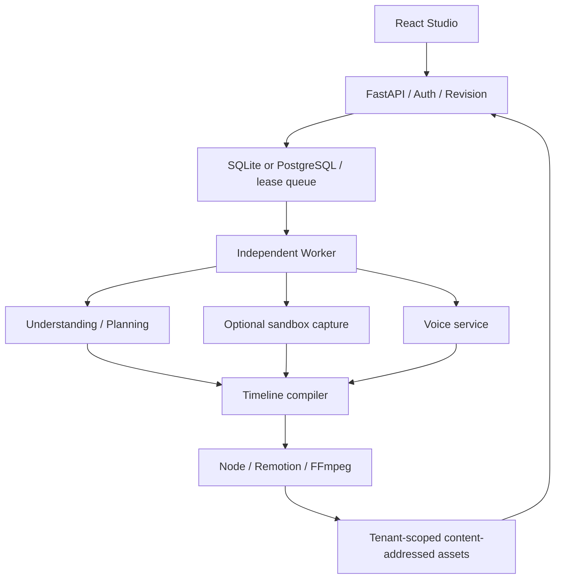

# 实现架构

## 1. 架构边界

本版将目标设计落成支持本地与共享存储的模块化应用：控制面 API、持久化任务 Worker、源码沙箱适配器、视频引擎和可选语音服务独立。API 不执行上传代码，也不在请求中等待渲染。

## 2. 为什么采用模块化 API 而非大量微服务

项目、输入、版本和任务需要一致事务；首版放在同一 API/数据库降低部署与跨服务事务成本。构建、录制、模型和渲染具有不同资源/安全要求，放在独立执行层。`adapters/` 是能力边界，不要求每个小适配器一个常驻服务。

## 3. 代码职责

| 路径 | 责任 |
|---|---|
| config.py | 环境配置、访问密钥生成、启动校验 |
| domain.py | 内容、分镜、场景、旁白与 API 输入协议 |
| security.py | Bearer/Cookie 身份、租户与资源授权 |
| db.py | Schema、事务、队列、租约、fence、事件 |
| storage.py | 按租户隔离的内容寻址素材 |
| api.py | HTTP 契约、配额、版本派生、导入导出 |
| services/ingestion.py | 安全归档、脱敏、静态理解与证据 |
| services/planning.py | 本地模板/受控模型与引用验证 |
| services/changes.py | 受限自然语言修改、可选模型修改 |
| services/pipeline.py | 阶段 DAG、检查点、素材提交和交付 |
| services/process.py | 有限输出、超时、取消及进程管理 |
| services/quality.py | 时间线、证据、运行真实性与媒体检查 |
| adapters/voice.py | eSpeak/Qwen、归一化与字幕估时 |
| adapters/runtime.py | Docker 隔离运行与显式清理 |
| packages/video | 预览与导出共用场景组件 |

## 4. 三层数据

ContentIR：主题、Claim、Evidence、语言与模块。

StoryboardIR：场景、标题、旁白、视觉类型、证据引用、时长预算。

编译后 StoryboardIR：同一协议增加实际 start_frame、frames、audio_id、media_id、cues 和总帧数。为控制首版规模，本版以同一带 schemaVersion 的模型表示创作与执行数据，而不是三套独立数据库；阶段由 checkpoint 区分。独立编译 IR 可在后续协议版本迁移。

## 5. 正常流程

HTTP 创建项目与不可变输入 → 创建 revision/job → Worker 原子领取 → 理解 → 规划 → 可选运行 → 配音 → 时间线 → 渲染 → 质量 → 导出 → 完成。

选择「先生成分镜」时，完成规划后即结束任务。用户修改后 fork 成新版本，原版本不变。

## 6. 任务一致性

- 队列使用 `BEGIN IMMEDIATE` 原子领取，避免两个 Worker 同时拿到新任务。
- 租约到期可重新领取，fence 增加；过期 Worker 无权完成任务或提交检查点。
- 阶段完成时将 revision 字段、outputs、checkpoint、事件放入同一事务。
- 音频/视频文件先写对象存储；事务失败留下可清理的未引用对象，不误标完成。
- 取消在最终提交中优先检查，不能把 CANCEL_REQUESTED 覆盖为成功。
- 源码重分析与同文本配音通过租户内音频缓存减少重做。不是通用的任意 DAG 内容缓存。

## 7. 时间与媒体

30fps、1080P，工作音频 48kHz。按累计时长计算边界，避免每段单独四舍五入产生累计漂移。实际语音长度优先，目标时长超出阈值时在报告中提醒；首版未实现硬时长约束优化器。

字幕为可读句段的长度比例估计；英文按词换行，中文按长度拆分。这是明确的近似，不是 ASR 或强制对齐。

## 8. 扩展和部署限制

SQLite/本地对象目录适合单机。不要通过 NFS 共享 SQLite 实现多节点。Temporal 可承接调度，但不会自动让数据库、素材、GPU 或浏览器分布式。多节点需 PostgreSQL、S3、Worker 租约与输出提交的完整适配及集成验收。

## V2 关键实现

- `postgres.py` 使用 psycopg 原生事务、SKIP LOCKED 原子领取、行锁 fence 和租户 advisory lock；SQLite 保留 BEGIN IMMEDIATE。
- `storage.py` 通过 boto3 存储到 S3 兼容服务，每个 Worker 独立缓存下载，以 SHA256 校验；数据库不存对象本机绝对路径。
- `temporal_worker.py` 将八个业务阶段与最终提交拆为九个 Activity。每阶段提交检查点后释放数据库租约，下一 Activity 可以迁到另一 Worker。正常阶段切换不消耗崩溃恢复次数。
- `project_plan.py` 将框架识别与执行解耦。`project-runner.mjs` 执行受限 JSON 动作与断言并捕获页面；上传源码路径只能通过隔离适配器运行。
- `timeline.py` 先计算有限语速是否满足预算，再按整数帧分配场景；锁定场景与完整旁白为硬约束。冲突失败并给出原因。
- `adapters/alignment.py` 调用独立语音环境，验证文本完整、时标有序且不超音频；零时长 DTW 字符合并到邻接实测片段，不能伪造逐字精度。
- Qwen HTTP 网关只处理鉴权与 IPC，模型运行于 seccomp 禁止 IPv4/IPv6 socket 的常驻子进程。

部署时先选同机 SQLite/本地存储，或 PostgreSQL/S3；多节点模式所有节点必须使用同一数据库、对象桶和租户密钥。无需共享 work 目录。源码执行服务和语音服务的资源与网络策略应分别管理。

## V2.1 原生执行层

Native AgentAdapter 位于 planning 阶段，采用独立容器驱动 Codex/Claude Code 的原生 Agent loop，返回 AgentDesign。它提供分镜、证据引用、代码展示文本与 diagram 动画数据；平台再次校验后才交给统一 Remotion 组件。原生场景修改通过 changes 创建新版本，在 Worker 异步执行，仅合并目标场景；brief.agent_change 在检查点事务中清除，避免后续仅渲染又调用模型。原生内部会话不作为平台状态存储，不支持跨供应商迁移内部记忆。
