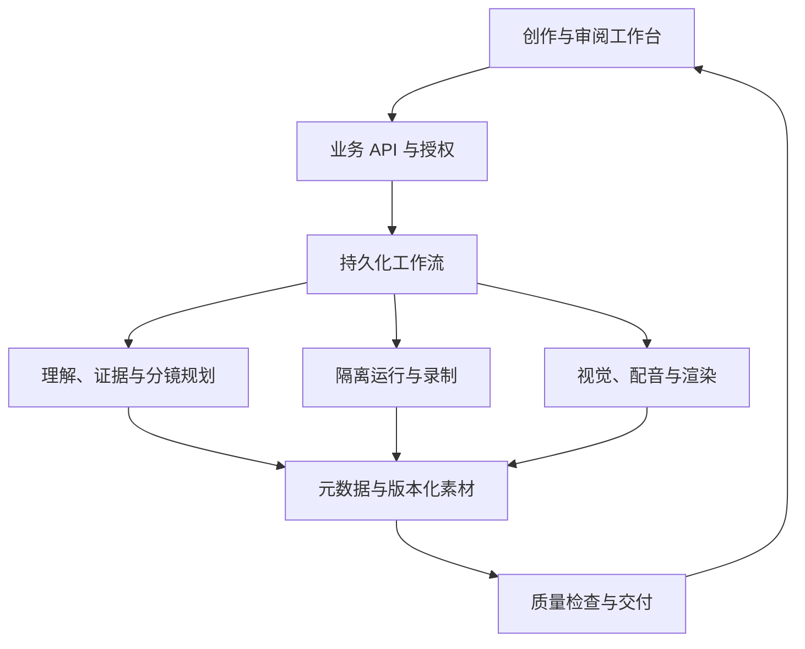
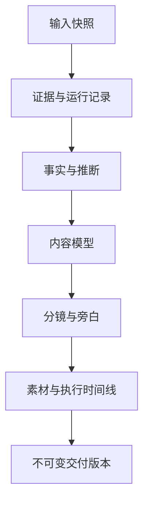
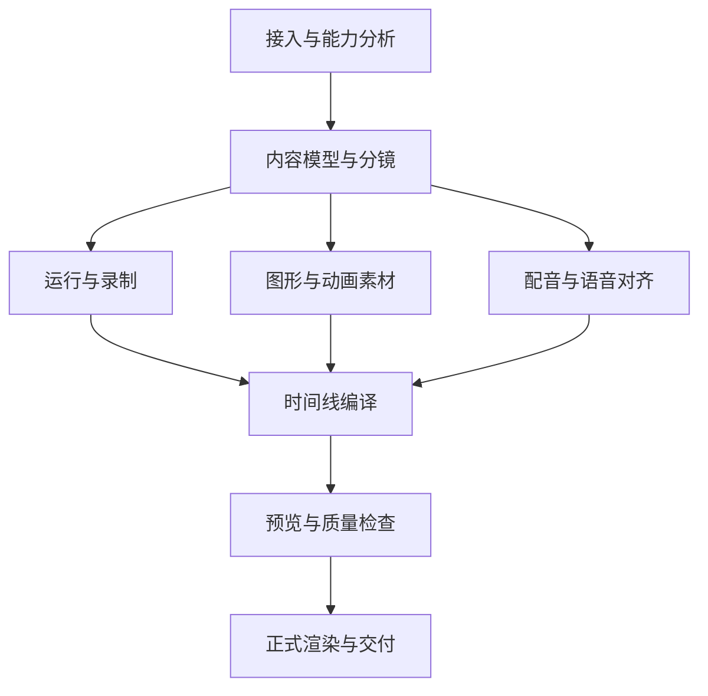

# 通用 AI 演示与讲解视频生成平台——完整设计方案 V1.0

版本日期：2026-10-28  
文档状态：建议设计基线，可用于立项、详细设计和开发拆解；不是已实现功能清单。  
适用对象：产品负责人、架构师、前后端工程师、AI 工程师、媒体工程师、测试与运维人员。

## 阅读导航

- 第 1–5 章：产品定位、通用性边界、使用流程与验收原则。
- 第 6–10 章：总体架构、内容模型、输入解析、源码理解与事实管理。
- 第 11–16 章：演示策略、运行录制、视觉生成、配音、时间线和渲染。
- 第 17–22 章：任务编排、插件、数据库、API、编辑器与增量更新。
- 第 23–29 章：质量、安全、部署、成本、测试、实施计划与风险。
- 附录：完整工程示例、配置、目录结构、接口约定和官方参考资料。

## 1. 产品定位与设计目标

### 1.1 一句话定义

用户输入任意项目源码或提示词，平台理解内容、组织讲解、制作演示与动画、生成旁白和字幕，输出可播放的视频和可继续编辑的视频工程。

平台服务软件、算法、工具库、API、数据分析、教学主题和概念方案，不绑定某个业务系统、固定角色或页面结构。

### 1.2 核心交付物

| 交付物 | 必备内容 | 用途 |
|---|---|---|
| 成片 | MP4、封面、时长与规格 | 播放、汇报、传播 |
| 讲解脚本 | 章节、旁白、画面与演示说明 | 审稿、复用、翻译 |
| 字幕 | SRT/VTT、烧录字幕可选 | 无障碍与多平台发布 |
| 旁白 | 分场景音频、全片音频 | 二次剪辑 |
| 可编辑工程 | 标准工程描述、素材清单、版本信息 | 局部修改、再次渲染 |
| 质量报告 | 已验证内容、未验证项、降级方式、技术检查 | 判断交付可靠性 |

可编辑工程以平台中立的 JSON/素材包为主；导出 Remotion 源码是可选能力，单独处理依赖、许可与版本兼容。

### 1.3 核心原则

1. 通用输入、分级理解、按能力选择输出路径。
2. 内容模型与视频表现解耦，技术栈适配与业务语义解耦。
3. 真实实现、设计意图、演示数据和生成设想可追溯、可区分。
4. 模型生成计划与结构化内容，受控程序执行构建、录制、计时和渲染。
5. 默认自动推进，只有缺少必要信息或需要扩大权限时才暂停。
6. 修改可局部生效，锁定项不能被静默改写。
7. 所有上传源码、生成代码、网页内容与第三方插件按不可信输入处理。

## 2. “任意输入”的承诺与能力分级

### 2.1 产品承诺

“任意”指统一入口接受多种项目和主题，并选择可实现、可说明的讲解方式；不承诺任意源码均能编译、运行、连接生产系统或获得物理设备。

支持的文本/源码经解析后可进入讲解；不支持的二进制、加密文件、无关文件、损坏归档应返回明确报告。用户要求真实演示但环境不足时，任务进入 PARTIAL 或 NEEDS_INPUT，不能伪报成功。

### 2.2 能力等级

| 等级 | 能力 | 事实要求 | 典型输出 |
|---|---|---|---|
| L0 主题讲解 | 理解提示词、整理知识 | 用户给定或外部证据；未检索时不宣称最新 | 图文、流程、概念动画 |
| L1 源码讲解 | 静态解析项目 | 文件、符号、配置、文档证据 | 模块、接口、代码与架构讲解 |
| L2 执行演示 | 在沙箱运行示例或 API | 成功执行记录 | 终端、请求响应、数据结果 |
| L3 真实交互 | 操作可运行应用 | 动作断言、录制、截图 | Web/应用界面演示 |
| L4 可验证教程 | 多步骤演示可复现 | 环境、数据、动作与结果闭环 | 教学视频、操作指南 |

等级按场景分别记录，同一个视频可混合 L1 架构讲解和 L3 页面演示。

### 2.3 不同输入的展示策略

| 输入 | 首选路径 | 降级路径 |
|---|---|---|
| Web 前端/全栈 | 构建、启动、浏览器探索与录制 | 页面截图、路由/流程/组件讲解 |
| REST/GraphQL 服务 | OpenAPI/Schema 分析、沙箱请求 | 接口与调用链动画 |
| CLI 工具 | 固定数据集运行、终端录制 | 命令与输出示例，明确未执行 |
| SDK/算法库 | 示例执行、输入输出与状态展示 | 关键代码、步骤动画 |
| Notebook/数据项目 | 受控执行、结果与图表 | 已保存结果或数据流程解释 |
| 桌面/移动应用 | 可用运行适配器录制 | 用户提供截图/录屏与流程动画 |
| 嵌入式/硬件项目 | 已配置模拟器/硬件测试环境 | 源码与设计层说明；不伪造实机结果 |
| 纯提示词 | 主题大纲、证据补充、场景生成 | 缩小范围或显式陈述假设 |

## 3. 用户、场景和需求

### 3.1 用户角色

- 创作者：导入内容、生成、修改、导出。
- 协作者：编辑获授权的脚本、场景或素材。
- 审阅者：预览、评论、标记问题，不默认拥有源码下载权限。
- 租户管理员：管理成员、配额、模型策略、资源保留与品牌。
- 平台运维：维护 Worker、模型与插件；默认不直接读取租户源码正文。

### 3.2 典型场景

1. 项目源码 → 产品介绍与功能演示。
2. 算法/SDK → 原理讲解与示例运行。
3. API 项目 → 接口教程与链路演示。
4. 提示词 → 科普、教学或方案讲解。
5. 新源码版本 → 更新受影响的视频章节。
6. 已有工程 → 修改时长、受众、语言、音色或品牌。

### 3.3 需求清单

| 编号 | 需求 | 级别 |
|---|---|---|
| FR-01 | ZIP、Git 快照、提示词与补充素材导入 | 首版 |
| FR-02 | 自动识别输入类型、项目入口与可用能力 | 首版 |
| FR-03 | 生成内容模型、脚本、分镜和事实来源 | 首版 |
| FR-04 | 提示词生成图文、流程、架构动画 | 首版 |
| FR-05 | Web、CLI、API 的受控运行与录制 | 分阶段首版 |
| FR-06 | 固定音色、多语种、字幕与发音词典 | 中文优先，持续扩展 |
| FR-07 | 在线预览、场景编辑、自然语言修改 | 首版 |
| FR-08 | 锁定内容、局部重建、版本比较 | 首版基础能力 |
| FR-09 | MP4、脚本、字幕和工程包导出 | 首版 |
| FR-10 | 质量报告、错误诊断与降级说明 | 首版 |
| FR-11 | API、Webhook、团队与租户隔离 | 内测到生产阶段 |
| FR-12 | 桌面/移动/模拟器扩展 | 后续适配器 |

### 3.4 非功能目标

以下为初始工程目标，正式 SLO 以压测和试用结果确定：

- API 与长任务分离；提交不阻塞等待视频生成。
- Worker 中断后可从已完成制品恢复，不从头重做。
- 每个版本可追溯输入、模型、模板、素材与运行镜像。
- 输出无已知解码错误；重要文字与关键操作不被裁切。
- 发布路径无未解决的阻断质量项；未验证事实清晰披露。
- 用户可以查看阶段进度、取消任务、导出已完成的部分成果。

## 4. 产品交互设计

### 4.1 新建流程

1. 输入源码或提示词，可追加文档、图片、Logo、示例数据。
2. 系统生成需求摘要：主题、受众、视频目标、关键章节、可运行性。
3. 应用默认配置自动生成，用户可选择先审脚本或直接生成预览。
4. 浏览器预览展示制作进度、章节和质量问题。
5. 用户自然语言或表单修改，系统给出影响范围并执行。
6. 导出文件，保存版本，支持导入新源码更新。

### 4.2 默认值

- 语言：随输入识别，无法判断时采用用户偏好。
- 受众：普通技术受众；可选管理者、初学者、专家、客户。
- 时长：默认 180 秒，自定义 30 秒至 15 分钟；长教程按章节组织。
- 风格：清晰专业，轻量转场，中文标题不强行套用英文版式。
- 画幅：16:9，1920×1080，30fps；兼容 24fps 和其他画幅。
- 生成方式：自动；可选脚本优先、逐章检查。
- 事实策略：基于证据；无证据的愿景用“设计目标/设想”表述。

### 4.3 编辑器布局

左侧章节和素材，中间预览，右侧当前场景配置，底部时间线；支持画面、字幕、旁白、动效、音乐与标注轨道。项目概况、运行环境和质量报告用抽屉展示，避免占据日常创作界面。

提供“锁定旁白、锁定时长、锁定素材、锁定品牌、只更新画面”操作。锁定冲突时显示具体冲突，不自动解除锁定。

### 4.4 自然语言修改

将“更专业一些”“只更新这个页面”“压缩到 90 秒”等请求转成结构化 ChangeSet：目标对象、变更类型、约束、依赖影响、成本预估、回退点。执行采用新 revision，旧版保持可用。

不清晰且会影响事实或权限的修改需要用户补充；字体、间距和常规镜头节奏由系统自主决定。

## 5. 输出与成功标准

### 5.1 任务结果类型

- SUCCEEDED：用户要求的目标满足，必选质量门禁通过。
- PARTIAL：视频可用，但某些要求未实现；列出替代方式与缺失项。
- NEEDS_INPUT：缺少必要配置、素材或权限，暂停对应分支。
- FAILED：没有可交付结果，保留诊断信息和已完成制品。
- CANCELED：停止新工作，按策略保留已完成制品。

### 5.2 成功不等于真实功能验证

“视频生成成功”和“功能运行验证成功”分别记录。静态源码足以形成 L1 讲解，但不能据此声称功能在生产可用。界面模拟回复须记录数据来源，在相关场景或伴随说明中按用户选定的真实性策略标识。

## 6. 总体架构



### 6.1 控制面与执行面

控制面管理身份、项目、版本、策略、任务编排和计量；不直接运行用户代码。执行面承担解析、构建、录制、推理、渲染和检测，由独立 Worker 与沙箱组成。

### 6.2 模块职责

| 模块 | 职责 | 不负责的内容 |
|---|---|---|
| Identity/Policy | 租户、成员、项目权限、模型数据策略 | 不接管场景生成 |
| Project/Input | 上传、Git 快照、附件、版本 | 不直接启动进程 |
| Understanding | 输入分类、源码与文档理解 | 不直接宣称运行成功 |
| Evidence | 事实、来源、冲突与验证状态 | 不渲染画面 |
| Planning | 受众适配、脚本、分镜、演示策略 | 不执行任意命令 |
| Runtime | 沙箱生命周期、构建、服务启动 | 不持有平台长期密钥 |
| Capture | 浏览器、终端、API、模拟器录制 | 不修改生产系统 |
| Visual | 图形、布局、动画与代码场景 | 不生成未授权事实 |
| Voice | 音色、发音、合成、语音对齐 | 不决定产品功能 |
| Timeline/Render | 时间约束、轨道编译、编码 | 不在线访问任意外链 |
| Quality | 规则、语义、音视频和真实性检查 | 不自行解除锁定项 |
| Revision/Export | 增量、快照、文件交付与回退 | 不覆盖历史版本 |

### 6.3 技术选型基线

前端 React/TypeScript；API FastAPI；长任务 Temporal；媒体 Worker Node.js/Remotion/FFmpeg；模型与 TTS Worker Python；数据库 PostgreSQL；对象存储 S3 兼容服务。向量检索为可选增强，不作为小项目首版强依赖。

首期使用模块化单体 API 与独立 Worker，不为每个 AI 职责建设微服务。高负载时按运行隔离、GPU、渲染和录制队列扩展。

## 7. 三层中间表示与证据模型

### 7.1 内容层 ContentIR

表达主题、能力、实体、关系、流程、输入输出、术语、受众和证据，与视频引擎及源码技术栈无关。

### 7.2 创作层 StoryboardIR

表达章节目标、旁白、画面类型、展示重点、动作、时间预算、真实性等级和节奏。此时可有时长预算，但不假装所有实际时间已经确定。

### 7.3 执行层 CompiledTimelineIR

表达已解析素材、准确时间、音视频轨道、字幕 cue、动效关键帧、裁切、坐标变换和渲染规格。通过结构校验与质量门禁后才进入正式渲染。

### 7.4 关键对象

| 对象 | 必备字段 |
|---|---|
| InputSnapshot | id、输入类型、内容 hash、来源、解析结果 |
| ContentModel | schemaVersion、主题、能力、流程、实体关系 |
| Claim | id、陈述、类型、证据、验证状态、冲突 |
| Evidence | 输入快照、文件/符号/页面/运行引用、内容 hash |
| CapabilityReport | 可用适配器、可运行性、限制、降级方式 |
| Scenario | 数据集、运行入口、动作、前后置断言 |
| Storyboard | 场景、旁白、展示意图、预算、锁定项 |
| Asset | 类型、存储引用、规格、来源、hash、权限 |
| VoiceProfile | 引擎、模型、参考、发音词典、授权信息 |
| Timeline | timebase、轨道、区间、锚点与变换 |
| Revision | 父版本、输入依赖、工程快照、状态 |

### 7.5 Claim 的状态

- declared：用户或文档声明。
- observed_static：在源码/配置中观察到。
- observed_runtime：在特定运行中观察到。
- verified：指定测试或断言通过；不外推为生产保证。
- inferred：基于证据推断，需要以推断语气表达。
- hypothetical：提示词设想或演示原型。
- conflicting / stale：证据冲突或输入更新后失效。

每项 verified 都关联具体 run、输入版本和断言；模型自评的 confidence 不能把 declared 自动提升为 verified。

### 7.6 数据关系



## 8. 输入接入与分类

### 8.1 输入渠道

ZIP/TAR 等受支持归档、Git 仓库快照、粘贴提示词；可附 Markdown/PDF、图片、录屏、Logo 和示例数据。首版不保证任意文件格式均可解析，无法识别的附件保留并报告。

Git 导入固定 commit；子模块、LFS、私有包和构建凭证需显式配置。凭证通过密钥引用传入，不进入工程 JSON、日志或模型上下文。

### 8.2 解析步骤

完整性检查 → 安全展开 → 文件分类 → 大文件/二进制过滤 → 编码检测 → 入口与依赖识别 → 文档与资源提取 → 能力报告。

初始限额可配置：归档 200 MiB、展开 1 GiB、50,000 文件；限制压缩比、嵌套层数、单文件和解析时间。这些是保护性默认值，正式数值按场景验证。

拒绝越界路径、非法链接与设备文件；检查 canonical path，不能仅依赖字符串前缀。原始上传只读保留，解析结果进入独立工作目录。

### 8.3 提示词解析

提取主题、视频目的、受众、语言、时长、风格、必讲/禁讲内容、事实要求和素材需求。默认先满足已知要求，不因每个非关键字段缺失而打断。

主题涉及需要查证的事实时，按租户策略检索可信来源；禁用检索时说明知识与来源限制。来源内容同样是不可信数据，不能成为工具执行指令。

## 9. 源码理解与大项目处理

### 9.1 分层分析

1. 项目层：manifest、构建入口、工作区、框架、服务与文档。
2. 结构层：AST、符号、导出接口、依赖、路由、Schema 与测试。
3. 业务层：用途、关键流程、功能、输入输出。
4. 演示层：用户可见入口、示例、可执行命令、测试 fixture。

先建立文件与符号索引，再按候选讲解点检索必要片段。不能将整个仓库一次性塞入模型，也不读取无关历史、密钥或生产样本。

### 9.2 可扩展语言分析

使用通用语法解析与语言专用适配器；无法生成 AST 时采用文本与文档分析并降低验证等级。不同语言适配器统一输出符号、关系和证据引用。

静态调用图只是近似，动态反射、配置注入和生成代码可能无法解析。视频不能把近似依赖图表述为已验证的实际请求链路。

### 9.3 大项目策略

- 自动识别 monorepo 子项目，展示候选入口。
- 先做总体介绍，再选 2–4 条关键流程深入；避免全文件讲解。
- 输入快照、索引和模块摘要按内容 hash 缓存。
- 模型上下文按文件/符号引用加载；摘要保留来源。
- 共享基础库、全局样式、锁文件变化扩大影响范围。

### 9.4 文档与代码冲突

同时保留“文档声称”和“实现观察”。能够验证的运行结果只覆盖本次环境。无法消解时选择限定表达，或将相关场景标记为需审阅，不用流畅文案掩盖冲突。

## 10. 讲解规划与内容真实性

### 10.1 规划输入

ContentIR、CapabilityReport、受众、目标时长、品牌、真实性策略、语言与用户锁定项。

### 10.2 规划输出

章节顺序、每章目标、旁白、展示方式、证据引用、运行/素材需求、时间预算、转场和检查项。

### 10.3 内容组织策略

| 视频目标 | 建议结构 |
|---|---|
| 产品介绍 | 背景 → 定位 → 核心能力 → 代表流程 → 价值 |
| 技术讲解 | 问题 → 核心机制 → 架构 → 运行示例 → 限制 |
| 操作教程 | 目标 → 前提 → 步骤 → 结果 → 常见问题 |
| 算法解释 | 输入 → 思路 → 状态变化 → 输出 → 复杂度/边界 |
| 概念科普 | 问题 → 定义 → 类比 → 过程 → 应用与误区 |

### 10.4 防止虚构

讲解稿中的可验证主张必须引用 Claim。数据图表区分实际、示例和推算。提示词生成的产品没有源码时，不称“系统已经实现”；性能、收益、准确率等不能任意编造。

界面截图不能证明后端逻辑正确，AI 示例回复也不能证明已连接真实模型或真实业务数据。质量报告记录这些边界，必要时在画面中简洁标识。

### 10.5 时长预算

先分配章节预算与最小展示时间，再以实际配音校准。中文字符与英文词数估算仅用于初稿；语速、术语和停顿都会影响长度。

硬上限下优先删减重复内容、减少章节、简化表达，再重新配音。若锁定脚本且自然讲解无法满足时长，报告约束冲突，不无限加速。

## 11. 展示策略引擎

### 11.1 场景类型

title、image_explain、ui_demo、terminal_demo、api_demo、code_walkthrough、architecture、flow_animation、algorithm_state、chart、comparison、summary。

通用模板负责可读性与基础动效，内容和布局按主题生成。特殊场景可由受控代码生成扩展，仍需校验和沙箱运行。

### 11.2 选择方法

规则首先检查必备能力与真实性等级，再用评分选择候选：

`score = w1*内容契合 + w2*验证可信度 + w3*可读性 + w4*受众适配 - w5*执行风险 - w6*时间成本`

评分权重通过基准数据调优，不作为不可解释的模型自评分。记录选择理由和降级候选。

### 11.3 单一主题的不同演示

以文件同步为例：有 UI 时录制选择目录与同步；有 CLI 时运行修改文件再同步；只有库时执行示例函数并显示差异；只有提示词时用目录、差异、传输和验证的流程动画。四者共享 ContentIR，但 Scenario 和素材不同。

### 11.4 无条件降级不可接受

如果用户要求“真实演示”，静态动画只是可选替代。应返回 PARTIAL/NEEDS_INPUT，并清楚标记未达要求，不将降级视频计为完整成功。

## 12. 运行、演示数据与交互录制

### 12.1 RuntimePlan

包含运行镜像 digest、依赖锁文件、工作目录、构建步骤、启动参数数组、端口、健康检查、数据准备、网络策略、资源限制和退出清理。命令使用参数数组或受控脚本，不拼接用户输入为 shell。

### 12.2 分阶段执行

静态检查 → 依赖准备 → 构建 → 启动 → 健康检查 → 预演 → 录制 → 制品提交 → 清理。每步输出日志、状态和内容 hash。

依赖安装可能运行生命周期脚本，同样属于不可信代码执行。即便禁止 install scripts，构建阶段仍不可信；不能把此配置当成完整安全边界。

### 12.3 网络与依赖

依赖通过受控代理下载，必要域名按策略开放。构建与录制阶段网络分别配置；禁止访问控制面、其他任务、宿主机、链路本地与云元数据服务。

Git、包安装器、HTTP 重定向和 DNS 解析均执行出口策略，不能只在最初 URL 上做一次检查。私有依赖凭证使用短期最小权限令牌，日志脱敏。

### 12.4 演示数据

优先用户提供的脱敏测试数据，其次隔离测试环境，再其次一致性 fixture 或 API Mock。统一 ScenarioData 管理实体、ID、日期、统计和状态，避免不同页面与 AI 回复互相矛盾。

Mock 必须遵循实际接口形状，不修改业务源码来制造成功。必要的测试入口或启动补丁单独存储为 overlay，记录 diff，不回写用户源快照。

Playwright 官方提供 API 拦截与 HAR 回放能力，可作为实现基础。[R3]

### 12.5 DemoAction DSL

动作包括 navigate、click、fill、press、select、scroll、wait_for、assert、request、run_example、capture。每个动作包含 target、前置条件、完成断言、超时和证据记录。

动作目标优先 data-testid、可访问角色/名称、稳定文本；CSS 次之；视觉定位仅作为补充。记录定位器版本、元素几何与动作事件，不把屏幕坐标作为唯一长期标识。

### 12.6 操作的时序与修复

先预演验证，再录制。等待 DOM、请求或状态变化，不依赖大量固定 sleep。超时后最多进行配置允许的局部修复；定位、权限、服务失败分别归因，不盲目重试所有动作。

真实外部测试环境只运行任务授权范围内的动作；危险/不可逆操作不能因“为了演示”而自动执行。可用隔离数据、回放或明确的 dry-run 替代。

### 12.7 不同录制方式

| 场景 | 采集方式 | 关键检查 |
|---|---|---|
| Web | 浏览器录像、元素截图、动作日志 | viewport、字体、页面状态、面板完整性 |
| CLI | stdout/stderr、退出码、终端帧 | ANSI 解析、脱敏、行数与可读性 |
| API | 受控请求/响应与执行记录 | Schema、耗时来源、状态码、敏感字段 |
| 算法 | 示例运行的结构化状态快照 | 测试输入、状态次序、输出正确性 |
| 桌面/移动 | 专用 VM/模拟器插件 | 系统权限、资源、兼容性与隔离 |

终端可以根据真实执行日志重绘，标注为日志重放；不能把伪造输出包装成执行录像。

### 12.8 可复现性

固定测试数据、浏览器版本、镜像、字体、区域和时区；可控时使用固定时钟。随机数据、异步网络和真实模型回复会破坏确定性，正式录制应冻结素材。不能宣称 seed 足以保证所有推理与浏览器输出逐字节一致。

## 13. 视觉与动画生成

### 13.1 图形语言

用 SVG/React/Canvas 描述节点、连线、标签、卡片、镜头与高亮。精确架构图和图表不依赖生成图片中的文字与箭头。生成式图片或视频适合背景、类比和氛围片段，作为可替换素材；不能充当真实 UI 或科学数据证据。

### 13.2 GraphScene

图形节点至少包含 id、语义类型、标签、层级、边界框、证据；边包含 from、to、关系、方向、锚点和路由。布局完成后执行重叠、出界、箭头截断和文字溢出检查。

产品图与技术图联动通过 semanticMapping 关联，不通过坐标猜测。例如用户功能映射 API、业务服务、Agent、存储，讲到某能力时联动对应元素。

### 13.3 动效约束

动作应解释关系：逐步显现说明顺序，沿线流动说明调用，状态变化说明执行结果。减少与内容无关的缩放和旋转。尊重可读停留时间和减少动态效果偏好。

### 13.4 设计系统

Theme 包含颜色、字体、字号级别、圆角、阴影、间距、字幕安全区和动效节奏。按画幅定义版式变体，不能把 16:9 直接等比缩小当作合格竖屏。

品牌包及字体保存许可与版本；字体覆盖所需字符。Logo 保持原始比例，禁止自动生成相似替代并冒充原品牌。

### 13.5 生成代码的控制

模板优先。特殊组件代码只可使用批准依赖和本地资产；通过 TypeScript、AST 规则、资源限制、快照与沙箱检查。禁止动态安装任意包、运行时网络和直接读取宿主机文件。

组件自由度越大，检测成本越高；首版通过扩展布局参数而不是开放任意 TSX 满足大多数需求。

## 14. 配音、发音与字幕

### 14.1 VoiceAdapter

统一接口：listVoices、designVoice、synthesize、estimate、normalize、align。适配器声明语言、语速、参考音色、风格、时间戳和部署能力；不假定所有 TTS 支持相同功能。

### 14.2 固定音色

以 Qwen3-TTS 为本地选项：VoiceDesign 生成参考音色，Base 复用 voice clone prompt 按章节合成。官方文档描述了该流程。[R4] 模型、参考音频、文本和参数固定版本；更换模型后重做试听与回归。

语音样本可能涉及真实人物，需保存用户授权范围与来源；默认优先合成设计音色。缓存音色特征与音频属于租户资产，不能跨租户共享。

### 14.3 DisplayText 与 SpokenText

保留字幕的标准书写形式，同时将数字、缩写、英文术语、多音字映射为可控朗读文本。发音词典分平台、租户、项目三级，项目覆盖不影响其他项目。

任何朗读归一化都应保留词语映射，便于字幕对齐。错误发音优先局部重生成，不通过粗暴切音拼字修复整段。

### 14.4 合成粒度

按完整语义句组或章节合成，避免逐条字幕导致断句。长段可拆成若干语义单元并统一音色、节奏与后处理；保留 raw 与 mastered 两级素材。

### 14.5 语音对齐

优先引擎可靠的时间戳；否则用支持相应语言的强制对齐器或 ASR 加已知文本匹配。领域词、数字归一化与标点需可逆映射。

ASR 匹配分数只表示自动检查结果，不等于人工听感或准确率保证。检查漏字、重复、异常停顿和置信度低的段落；不确定时标记试听或重生成。

### 14.6 响度与混音

初始目标可设综合响度 -16 LUFS、真峰值不高于 -1.5 dBTP，具体随发布渠道调整；这属于工程配置，不是所有场景的统一标准。最终验收使用成片混音结果，不能拿 mean_volume dB 当 LUFS。

音乐默认关闭或低音量，开启时旁白侧链衰减。保留音轨布局和重采样策略，防止单声道转立体声后响度变化。采用 FFmpeg 等工具的响度测量与归一化能力。[R7]

## 15. 时间线编译与音画同步

### 15.1 两种时间模式

- 内容优先：脚本与演示需要多少合理时长，就生成对应长度，仍受用户上限约束。
- 时长优先：按目标预算调整脚本、镜头和可选内容，必要时重新合成。

### 15.2 时间线编译顺序

脚本预算 → 场景预演 → 配音与素材并行生成 → 获取真实时长和事件 → 解时间约束 → 对齐字幕 → 生成最终帧时间线。

### 15.3 时间表示

时间用整数微秒或明确的有理数时间基准存储，最后统一转换为帧与音频样本。所有区间采用左闭右开 `[start,end)`，累计边界统一舍入，避免每段独立舍入产生漂移。

支持 24/30fps，后续扩展 NTSC 时保存有理数帧率。音频建议工作流统一 48kHz，最终输出按编码需求处理；不能假设任意帧率都能整除采样率。

### 15.4 动作与声音锚点

每个动作记录媒体时间戳，例如 panel_expanded 在源录屏第 2.4 秒；旁白“展开助手”有音频 cue。编译器求出裁切与分段变速映射，使两者匹配，同时保留前置动作顺序和最小停留时间。

不能仅用文字字符索引比例推算时刻作为正式精确同步，也不能使用整段单一变速解决所有交互时序。

### 15.5 速度与停留约束

- UI 输入和点击保留人可理解的节奏。
- 网络等待可裁短，但结果不能提前到触发动作之前。
- 阅读结果时允许静帧停留；动效仍运行的画面不宜生硬冻结。
- 旁白轻微变速需试听，超出配置阈值优先改稿或重合成。
- 字幕有最大行数、最短显示时间和阅读速度约束，按语言配置。

### 15.6 冲突处理

例如“旁白锁定 20 秒、画面锁定 25 秒、章节上限 18 秒”不可满足。返回 TIMELINE_CONSTRAINT_CONFLICT，列出需要放宽的条件；不裁掉未讲完的语音或重要操作。

## 16. 视频编译、预览与渲染

### 16.1 Compiler

验证 IR → 解析并授权素材 → 固化资源 → 字体检查 → 选择场景 Renderer → 编译 Composition → 输出关键帧/预览/成片。

Remotion 支持通过 props 驱动内容、通过 calculateMetadata 计算动态规格，适合作为默认渲染后端。[R1] 同时保留 RenderAdapter，避免中间表示绑定某个引擎。

### 16.2 确定性约束

正式渲染不在线生成内容，不依赖真实时钟和非固定随机数，不动态请求外部素材。按帧计算动画。所有视频和字体先进入资源服务并完成授权，限制渲染器访问网络。

浏览器预览和导出共用版本、资源与时间线。缩略图/代理媒体只改变清晰度，不改变几何比例、字幕、转场和时间位置。

### 16.3 渲染策略

关键帧先检查，低清代理再预览，正式渲染最后执行。初期整片渲染；后续可按场景渲染并缓存，但跨场景转场、音频包络与帧边界需要专门拼接策略。

场景缓存不意味着最终 MP4 可以任意字节拼接。分片应统一编码参数，必要时重新编码或使用中间格式，再验证音画与时长。

### 16.4 制品提交

Worker 写入临时对象，完成校验后以内容 hash 提交；通过数据库事务将 render 状态与 artifact 引用切换为完成。未完成对象不向用户暴露为最终文件。

### 16.5 导出包

工程包包含 schema 版本、IR、已授权素材、字幕、脚本、音频和 manifest。默认不包含原始业务源码、私有依赖缓存、密钥、运行日志中的敏感内容。可下载权限分别控制视频、源码、旁白、工程和证据。

## 17. 任务编排、状态与恢复

### 17.1 工作流分工

Temporal 负责持久化阶段、超时、重试、取消和恢复。[R5] 模型调用、文件 I/O、数据库、构建和媒体处理放在 Activity/Worker；工作流决策保持确定性。

LangGraph 为可选的规划/修复子流程，不替代任务持久化与媒体队列。不要在两层各自无限重试，定义清晰的错误归属和预算。

### 17.2 阶段依赖



图形和配音可并行；需要实际交互事件的时间线必须等录制事件完成。质量检查可按素材提前执行，不必都等到最终文件。

### 17.3 Job 与 Stage 状态

Job 状态：QUEUED、RUNNING、NEEDS_INPUT、PREVIEW_READY、FINALIZING、SUCCEEDED、PARTIAL、FAILED、CANCEL_REQUESTED、CANCELED。Stage 独立记录 PENDING、RUNNING、RETRYING、SUCCEEDED、SKIPPED、FAILED、CANCELED。

PREVIEW_READY 表示已有可用预览，不代表正式导出已完成。FAILED 分支与可交付分支共存时，按必选目标计算 PARTIAL。

### 17.4 超时与重试

初始策略示例：模型请求 90 秒、2 次瞬时错误重试；构建 10 分钟；服务就绪 2 分钟；动作 15 秒；模型驱动动作修复最多 2 次；渲染按分辨率/帧数计算超时。正式值按基准校准。

权限错误、损坏输入、缺少密钥和不支持格式不自动重试。指数退避处理临时失败，超预算转 PARTIAL/NEEDS_INPUT/FAILED。

### 17.5 幂等与一致性

至少一次执行下，Activity 通过 `revision + stage + inputHash + adapterVersion` 生成幂等键。制品内容寻址，最终提交用 compare-and-set，避免 Worker 重试重复写入或重复计量。

API 接受 Idempotency-Key；相同 key 但不同请求体返回冲突。事件用数据库 outbox/等效事务机制发布，消费者按 eventId 去重。

### 17.6 取消与费用

取消先记录 CANCEL_REQUESTED，停止新阶段并向进程树/沙箱发送取消。长任务通过 heartbeat/检查点响应。完成与取消竞争以最终提交事务判断；不能同时显示完成和取消。

释放沙箱、GPU 租约、配额预留与临时对象。费用按唯一 usage event 汇总，预留额度与实际用量分开，不把重试内部重复计量给用户。

## 18. 插件与适配器协议

### 18.1 类型

SourceAdapter、RuntimeAdapter、CaptureAdapter、VisualizationAdapter、VoiceAdapter、AlignmentAdapter、RenderAdapter、QualityAdapter、ExportAdapter。

### 18.2 核心接口示意

```typescript
interface AdapterContext {
  tenantId: string;
  projectId: string;
  revisionId: string;
  policyRef: string;
  artifactNamespace: string;
  cancellationToken: string;
}

interface RuntimeAdapter {
  manifest: AdapterManifest;
  detect(input: InputManifest): Promise<DetectionResult>;
  plan(input: InputManifest, policy: Policy): Promise<RuntimePlan>;
  prepare(plan: RuntimePlan, ctx: AdapterContext): Promise<RuntimeHandle>;
  execute(handle: RuntimeHandle, scenario: Scenario): Promise<RunEvidence>;
  dispose(handle: RuntimeHandle): Promise<void>;
}
```

这些接口跨进程时由版本化 JSON Schema/gRPC 契约承载，不要求 Python 和 Node 直接共享内存对象。

### 18.3 插件声明

manifest 包含 id、版本、协议范围、支持类型、能力、镜像 digest、资源需求、网络需求、作者、签名、许可证和兼容性测试结果。平台允许清单决定安装，不允许上传项目自动注册系统级插件。

### 18.4 执行权限

能力型 token 只允许读取该任务输入和写入指定素材命名空间。密钥采用引用与运行时短期注入。插件不能调用任意平台 API，也不能获得租户管理员凭证。

新插件必须通过检测、超时、取消、畸形输入、隔离和制品校验测试；版本升级采用灰度与回退。

## 19. 数据库与存储设计

### 19.1 核心表

所有租户表带 tenant_id；id 使用不可猜测 ID，但不能靠 ID 难猜实现授权。

| 表 | 关键字段 | 约束 |
|---|---|---|
| tenants | id、name、policy_ref | 租户配置独立 |
| memberships | tenant_id、user_id、role | tenant/user 唯一 |
| projects | id、tenant_id、name、owner_id | 项目权限绑定 |
| input_snapshots | id、project_id、kind、hash、source_ref | 快照不可变 |
| analyses | id、input_id、model_version、content_ref | 绑定确切输入 |
| claims | id、analysis_id、type、state、statement | 不跨版本覆盖事实 |
| evidence_refs | id、input_id/run_id、locator、hash | 来源可追溯 |
| video_projects | id、project_id、brief_ref | 一个项目可有多个视频 |
| revisions | id、video_id、parent_id、etag、ir_ref | 可发布版本不可变 |
| scenes | revision_id、scene_id、order、spec_ref | revision/scene 唯一 |
| scenarios | id、revision_id、runtime_plan_ref、data_ref | 绑定运行策略 |
| jobs | id、revision_id、status、required_goals、budget | 状态版本乐观锁 |
| stage_attempts | job_id、stage、attempt、input_hash、error | 尝试完整留存 |
| runs | id、scenario_id、sandbox_ref、result_ref | 指向执行证据 |
| assets | id、tenant_id、hash、kind、metadata、storage_ref | 对象权限独立 |
| asset_dependencies | revision_id、child_id、parent_ref、role | 构建依赖图 |
| renders | id、revision_id、profile、status、artifact_id | 渲染规格固定 |
| quality_findings | id、revision_id、severity、code、target | 问题可定位 |
| voice_profiles | id、tenant_id、engine、model、reference_ref | 授权与版本 |
| usage_events | id、tenant_id、job_id、kind、units、cost | 去重键唯一 |
| export_packages | id、revision_id、manifest_ref、expires_at | 独立下载授权 |
| outbox_events | id、aggregate_id、payload、published_at | 事务消息 |
| audit_events | id、actor、action、resource、time、result | 追加写，脱敏 |

### 19.2 索引与关联

按 tenant/project、job/status/created_at、revision/scene、asset/hash、event/dedup_key 建索引。跨表关系使用带 tenant_id 的复合引用或等效约束，防止错误关联其他租户资源。

数据库行级策略可作纵深保护，服务端仍逐请求校验。共享项目需要授权关系，不能通过把 tenant_id 改为空来实现。

### 19.3 对象存储

按租户隔离命名空间：inputs、analysis、recordings、audio、visuals、timelines、renders、exports、diagnostics。对象键不包含凭证或敏感名称，下载使用短期签名并校验调用者权限。

正文大文件存对象，数据库保存 hash、MIME、尺寸、时长、来源和状态。敏感素材禁止跨租户 hash 去重，防止存在性泄露；公共字体等批准资源可独立共享。

### 19.4 生命周期

原始源码、临时运行和成片分别设置保留策略。默认建议临时运行数据 24 小时、失败诊断 7 天、工程/成片按租户配置保留；以合同与用户设置为准。引用计数/标记清扫保护仍被版本使用的素材。

删除任务覆盖原文件、衍生文本、向量、缓存和导出包；备份按明确的保留周期过期，不能承诺即时擦除全部离线备份。

## 20. API 与事件设计

### 20.1 API 规范

路径使用 /v1；JSON 采用统一字段风格。鉴权、租户、项目权限、资源权限逐层校验；写操作支持 requestId、Idempotency-Key 或 If-Match。分页采用 cursor，不暴露数据库游标内部结构。

| 方法与路径 | 功能 |
|---|---|
| POST /v1/projects | 创建项目 |
| POST /v1/projects/{id}/uploads | 申请受限上传会话 |
| POST /v1/uploads/{id}/complete | 校验并提交输入快照 |
| POST /v1/projects/{id}/git-imports | 固定 commit 导入 |
| POST /v1/projects/{id}/analyses | 分析输入与能力 |
| POST /v1/video-projects | 创建视频与生成目标 |
| POST /v1/video-projects/{id}/revisions | 从当前/指定版本派生 |
| PATCH /v1/revisions/{id}/draft | 乐观锁修改草稿 |
| POST /v1/revisions/{id}/changes | 自然语言转 ChangeSet |
| POST /v1/revisions/{id}/builds | 构建内容、素材和预览 |
| POST /v1/revisions/{id}/renders | 正式导出 |
| GET /v1/jobs/{id} | 状态、阶段和可用成果 |
| GET /v1/jobs/{id}/events | SSE 进度与问题 |
| POST /v1/jobs/{id}/cancel | 取消 |
| POST /v1/jobs/{id}/resume | 补充配置后继续 |
| GET /v1/revisions/{id}/quality | 质量与真实性报告 |
| POST /v1/revisions/{id}/exports | 工程包或其他输出 |
| GET /v1/artifacts/{id}/download | 授权下载 |

### 20.2 创建生成任务示例

```json
{
  "inputSnapshotIds": ["inp_01"],
  "brief": {
    "goal": "解释项目用途、核心机制并演示典型用法",
    "audience": "developer",
    "language": "zh-CN",
    "duration": {"mode": "target", "targetSeconds": 180, "maxSeconds": 210},
    "truthPolicy": "evidence_based",
    "executionPolicy": "sandbox_only"
  },
  "output": {"width": 1920, "height": 1080, "fps": {"num": 30, "den": 1}},
  "automation": {"mode": "automatic", "allowLabeledFallback": true}
}
```

返回 202 和 jobId、revisionId、statusUrl、eventUrl；不阻塞等待生成。对“必须真实演示”的请求，将对应 goal 标为 required，降级不能满足该 goal。

### 20.3 错误结构

```json
{
  "error": {
    "code": "RUNTIME_MISSING_CONFIGURATION",
    "message": "运行需要提供测试服务地址或选择模拟数据",
    "retryable": false,
    "stage": "runtime_prepare",
    "details": {"requiredFields": ["testApiEndpoint"]},
    "requestId": "req_01"
  }
}
```

其他错误码包括 INVALID_ARCHIVE、UNSUPPORTED_INPUT、BUILD_FAILED、RUNTIME_POLICY_DENIED、ACTION_ASSERTION_FAILED、MODEL_SCHEMA_INVALID、VOICE_ALIGNMENT_LOW_CONFIDENCE、TIMELINE_CONSTRAINT_CONFLICT、RENDER_FAILED、QUALITY_BLOCKED、QUOTA_EXCEEDED、REVISION_CONFLICT。

### 20.4 事件

事件包含 eventId、schemaVersion、tenantId、jobId、revisionId、stage、sequence、timestamp、type、payload。类型包括 stage.started、artifact.ready、finding.created、preview.ready、job.needs_input、render.progress、job.completed。

SSE 支持 Last-Event-ID 恢复；进度以阶段与工作量估算显示，不伪装成精确剩余时间。Webhook 使用 HMAC、重试、过期时间与 eventId 去重；回调地址必须经过 SSRF 防护。

## 21. 编辑器与协作实现

### 21.1 编辑粒度

支持脚本句段、场景顺序、画面来源、图形模块、镜头、字幕、音色和品牌。任何编辑都更新结构化数据，不直接修改已发布的视频二进制。

### 21.2 Draft 与 Published

Draft 允许编辑，发布形成不可变 revision；正在渲染的 job 固定其输入快照。用户编辑时派生草稿，不能让运行中的 job 读到变化的一半配置。

### 21.3 并发控制

首版使用场景级编辑锁加 ETag/If-Match。冲突返回差异与可选合并，不最后写入覆盖。多人实时协作后续可引入 CRDT，但不作为视频生成首版阻塞项。

### 21.4 预览一致性

编辑器加载同一个 CompiledTimelineIR、组件版本和字体。布局修改触发关键帧检查；旁白修改触发相关对齐。质量问题定位到场景、轨道、时间和元素。

## 22. 增量更新与锁定策略

### 22.1 依赖图

输入文件/符号 → Claim/流程 → 分镜 → Scenario/音频/视觉素材 → 时间线 → 渲染。Theme、字体、模型、插件和镜像也属于依赖。

### 22.2 更新算法

1. 比较输入快照与配置。
2. 失效相关证据和内容节点。
3. 沿依赖图计算受影响的素材与场景。
4. 校验锁定项与时间约束。
5. 生成 ChangeSet 与执行 DAG。
6. 复用缓存，重建失效节点，重新验收。

### 22.3 缓存键

`hash(tenantScope, normalizedInputRefs, schemaVersion, adapterVersion, templateVersion, modelRevision, voiceProfileRevision, renderProfile, relevantConfig)`。

内容 hash 用于识别素材，不能替代权限校验。模型缓存的重用表示复用既有输出，而非保证重新推理得到相同结果。

### 22.4 更新矩阵

| 修改 | 必须失效 | 通常可复用 |
|---|---|---|
| 页面局部源码 | 页面探索、相关录制、场景验证 | 无关音频和图形 |
| 全局样式/组件 | 所有受影响页面与坐标 | 脚本和配音 |
| 讲解文字 | 对应音频、字幕、时间锚点 | 原始录制和大部分图形 |
| 音色 | 全部旁白与相关时间线 | 原始视觉素材 |
| 语言 | 翻译、配音、字幕、布局溢出检查 | 可独立复用的录制 |
| 品牌 | 主题/Logo/字体相关场景 | 原始声音与录制 |
| 目标时长 | 规划与时间线，可能涉及脚本 | 满足约束的素材 |

“只更新 UI”下旁白不变，但新 UI 与旁白冲突时要返回问题；不能为了保持字节不变而交付误导内容。

## 23. 质量门禁与自动修复

### 23.1 检查层次

| 层次 | 检查项 | 阻断示例 |
|---|---|---|
| 结构 | Schema、引用、资源存在、时间合法 | 素材缺失、非法时间区间 |
| 真实性 | Claim 与证据、演示来源 | 将模拟结果称为真实执行 |
| 运行 | 退出码、动作断言、错误页面 | 必需真实演示失败 |
| 视觉 | 溢出、裁切、箭头、字号、字体、遮挡 | 关键按钮/文字不可见 |
| 声音 | 解码、漏字、重复、停顿、响度 | 旁白截断、明显削波 |
| 同步 | 动作与旁白 cue、字幕 | 讲解与页面不匹配 |
| 成片 | 分辨率、帧率、全片解码、时长 | 损坏文件、超硬上限 |
| 修改 | 锁定项与依赖比较 | 未授权重写旁白或其他场景 |

### 23.2 规则和模型的分工

几何、解码、尺寸、时长、事件断言等用确定性程序；语义不符、画面理解和讲解清晰度可用视觉/语言模型辅助。模型不能单独宣布科学结论已验证，也不能替代全部人工审片。

深色首页不直接判黑屏，图表停留不直接判卡住；检测必须结合场景目标。相同像素多帧只产生候选问题。

### 23.3 修复闭环

finding → 分类 → 选择局部修复 → 新候选资产 → 重检 → 提交。最多执行配置预算内的修复；每次保留 diff。无法修复返回可读错误，不进入无限“生成—评分—生成”。

### 23.4 真实性报告

列出每个场景的素材类别、验证等级、外部来源、演示数据标识、未解决冲突、降级原因与重要限制。报告与 revision 固定关联，不能导出旧报告配新成片。

## 24. 安全、多租户与隐私

### 24.1 安全边界

上传源码能执行安装脚本、编译器和服务，必须与控制面隔离。建议采用经过验证的 gVisor/微虚拟机等方案，独立构建、浏览器与渲染执行池；具体兼容性和性能需要验证。[R6]

### 24.2 必备控制

- 任务级文件系统、用户、进程与网络隔离，CPU/内存/磁盘/时间配额。
- 不挂宿主机 Docker socket、不授予 privileged、不暴露平台数据库与云长期凭证。
- 出口策略防 SSRF、DNS 重绑定和重定向绕过；清理不可绕过浏览器代理的通道。
- 用户源码、生成代码和插件只能写任务目录，制品出沙箱经过类型与内容检查。
- 模型提示中的工具调用经过独立策略层校验，不能用仓库文字扩大权限。
- 截图、日志、HAR、浏览器 profile 和音频同样视为可能敏感的素材。

### 24.3 源码到模型的数据策略

每租户可选本地模型、批准外部服务、仅摘要外发或禁止外发。执行前按策略做密钥与敏感数据过滤，记录发送范围和提供方；不得默认把完整私有仓库发送给外部模型。

模型出口策略和运行依赖下载是两条不同权限，不能因允许 npm 下载就允许外发源码。

### 24.4 资源权限

Project ACL 控制协作，artifact 权限继承但可收紧。只有视频观看权的人不默认拥有源码、HAR、密钥配置或完整工程下载权。共享链接可撤销、可过期，不暴露桶公开读取。

### 24.5 下载与预览

导出包进行路径和秘密扫描；上传 HTML/SVG、生成组件和浏览器预览使用独立 origin/CSP，避免用户内容在控制台域执行。渲染器解析资源 ID，不接受任意本地路径或未经验证的外链。

### 24.6 数据清理与审计

任务结束释放沙箱和临时凭证。审计记录谁导入、运行、授权、修改、导出和删除；不记录明文密钥。对读取生产数据或向外部系统写入的功能采用独立明确授权，首版默认不提供生产写入能力。

## 25. 部署、容量与可观测性

### 25.1 部署阶段

- 开发：API、数据库、对象存储和任务服务单机；不可信代码仍在沙箱。
- 内测：CPU、浏览器、GPU、渲染分离 Worker；固定基础镜像与模型。
- 生产：控制面高可用，独立沙箱节点池、GPU 池、录制池和渲染池，任务按资源与策略路由。

### 25.2 初始压测配置建议

CPU Worker 16 核、32–64 GiB；TTS 可用单卡 16–24 GiB 显存起测；实际显存、吞吐和并发由模型版本、精度、批量与输入长度决定。GPU 不是所有渲染阶段的加速保证，浏览器绘制、解码、编码要分别测量。

未知源码初始每沙箱可设置 2–4 vCPU、4–8 GiB、临时磁盘和执行时间限制；大型构建通过队列选择更大规格，不无限放宽默认配置。

### 25.3 容量公式

`Worker数 ≈ 到达任务数 × 该阶段平均服务时间 ÷ (服务窗口 × 目标利用率)`。

示例：一天 100 个任务、每个某阶段占用 12 分钟、8 小时服务窗口、目标利用率 60%，需要约 5 个该阶段 Worker 槽位。这只是该阶段的均值估算；还需按峰值、P95、并发和资源冲突压测。

### 25.4 监控指标

队列长度与等待时间、阶段 P50/P95、构建成功率、真实动作断言通过率、降级率、修复次数、TTS 实时系数、渲染帧速、GPU/CPU/内存、每分钟成片成本、缓存命中率、取消清理耗时和跨租户拒绝事件。

traceId 贯穿 API、工作流、模型、运行、录制和渲染。日志按任务聚合并脱敏，不能仅依赖大段模型会话定位故障。

### 25.5 告警与恢复

关键告警包括沙箱泄漏、配额耗尽、GPU 不可用、模型出口策略异常、渲染错误激增、长期未心跳和对象存储提交失败。采用租约与看门狗清理失联运行环境。

数据库定期备份，对象与工程快照有恢复演练；Temporal 与数据库、对象存储分别设置恢复策略，不能只备份最终 MP4。

## 26. 成本、计量与许可

### 26.1 成本模型

单次成本由输入解析与模型 token、构建时间、运行/录制时间、TTS GPU/CPU 时间、渲染时间、存储、下载和软件许可构成。估价以阶段资源账本为基础，不只按视频时长收费。

生成前估算预算并预留额度；执行中达到阈值时按用户配置缩小可选部分或暂停。不能降低必选真实性要求来隐藏预算超支。

### 26.2 降本顺序

关键帧先验收 → 代理预览 → 缓存理解/录制/音频 → 局部重建 → 正式导出。低复杂度场景使用固定模板，昂贵视觉生成只用于需要的段落。

### 26.3 软件与素材许可

Remotion 为源码可见软件，遵循其自身许可。官方 FAQ 区分基于模板/AI 生成视频的应用和接收任意用户 Remotion 工程的渲染服务。[R2] 本产品默认接收业务项目源码或提示词，由平台生成视频工程；若支持上传现成 Remotion 工程或交付 Remotion 源码给客户，应单独评估适用条款。

不在本设计中固定未来价格或法律结论。部署前检查实际版本、商业模式、编解码器、字体、音乐、模型权重及语音参考的许可与授权，建立依赖/素材许可清单。

## 27. 测试、基准集与验收

### 27.1 基准项目集

至少包含 Web、API、CLI、SDK/算法、Notebook、纯提示词、不完整项目、超大 monorepo、需要外部服务的项目和恶意归档。每类选择多个不同框架与复杂度，不以单一示例证明通用性。

### 27.2 测试层次

- 单元：IR 校验、时间换算、依赖失效、缓存键、权限和成本计算。
- 契约：插件协议、API、事件、模型结构化输出和素材元数据。
- 集成：沙箱、对象存储、队列、模型、浏览器、TTS 与渲染。
- 端到端：输入到视频、修改到局部更新、取消和中断恢复。
- 安全：恶意安装脚本、路径穿越、SSRF、资源耗尽、提示注入、跨租户资源。
- 媒体：帧数、音频样本、字幕、箭头、字体、同步和全片解码。

### 27.3 具体验收用例

| 编号 | 场景 | 验收 |
|---|---|---|
| AT-01 | 仅提示词 | 无需源码生成脚本、动画、旁白、字幕与可编辑工程 |
| AT-02 | 可运行 Web | 录制关键动作，断言和实际画面一致 |
| AT-03 | 后端 API | 真实请求与结果有证据，动画与数据一致 |
| AT-04 | CLI/算法 | 运行成功，输入/输出可追溯 |
| AT-05 | 构建失败 | 明确报告，允许 L1 替代，不能伪称真实操作 |
| AT-06 | 更新某模块 | 相关场景更新，锁定音频 hash 不变 |
| AT-07 | 修改旁白 | 只重做对应声音/字幕/同步，其他素材复用 |
| AT-08 | Worker 中断 | 从制品和检查点恢复，无重复计费 |
| AT-09 | 取消 | 后续阶段不启动，沙箱与租约释放 |
| AT-10 | 并发编辑 | 冲突可见，已发布和渲染中的版本不变化 |
| AT-11 | 恶意输入 | 不能访问宿主机、其他租户和平台密钥 |
| AT-12 | 时长锁定冲突 | 明确返回不可满足约束，不截断旁白 |

### 27.4 初始发布门禁

确定性 fixture 基准中可设 ≥95% 完成率作为内部起点，但必须注明测试集与版本；不能转化为对任意项目的成功率承诺。关键安全用例必须全部通过，未知项目单独报告能力与降级。

成片全片解码通过、必选断言通过、零未处理阻断项、锁定项符合、来源报告齐全后才标 SUCCEEDED。可读性、同步误差和语音阈值按语言、场景制定，不使用单一万能评分。

## 28. 开发计划与交付拆分

### 28.1 团队假设

1 名前端、1 名平台后端、1 名 AI/理解工程师、1 名媒体/运行工程师，测试和设计部分投入。工期为规划估算，取决于适配器范围、现有基础设施和质量要求。

### 28.2 阶段计划

| 阶段 | 交付 | 估算 |
|---|---|---|
| P0 基础契约 | ContentIR/StoryboardIR/TimelineIR、权限、素材、任务框架、基准集 | 2 周 |
| P1 提示词闭环 | 通用主题、6–8 类场景、TTS、字幕、预览与导出 | 3–4 周 |
| P2 源码理解 | 快照、索引、证据、架构/代码/接口讲解 | 2–3 周 |
| P3 真实演示 | Web/CLI/API 适配器、沙箱、Mock、录制与断言 | 3–4 周 |
| P4 生产化 | 增量、团队、质量修复、预算、恢复、压测和安全加固 | 3–4 周 |

顺序累计约 13–17 周，部分可重叠；这是覆盖多类输入的生产化范围，不是单一演示样例的开发时间。第一个可用的“提示词到视频”纵向版本应在 P1 结束交付。

### 28.3 首版范围

通用提示词和源码静态讲解；Web 支持 Vue/React 常见 Vite 项目，CLI/API 优先 Python/Node；输入、输出与 IR 始终通用。桌面、移动和硬件通过后续适配器扩展，不阻塞核心平台。

不以“支持所有技术栈运行”作为首版验收条件，而以“未知类型能报告并生成有依据的替代讲解”作为通用性验收。

### 28.4 主要研发任务

| 工作包 | 主要任务 |
|---|---|
| WP-01 工程协议 | Schema、迁移、校验、版本、样例与 SDK |
| WP-02 接入与理解 | 上传、Git、解析、索引、Claim 与证据 |
| WP-03 规划 | 受众、脚本、场景选择、约束与发音 |
| WP-04 运行 | 沙箱、依赖、构建、服务、网络、清理 |
| WP-05 录制 | 动作 DSL、预演、数据、事件与素材 |
| WP-06 视频 | 视觉组件、布局、动画、时间线、渲染 |
| WP-07 声音 | VoiceAdapter、音色、合成、对齐与混音 |
| WP-08 创作台 | 输入、编辑、预览、修改、问题、导出 |
| WP-09 平台 | 权限、计量、任务、存储、运维与审计 |
| WP-10 质量 | 基准、安全、真实性、媒体检查和修复 |

## 29. 风险与关键决策

| 风险/决策 | 处理方式 |
|---|---|
| 任意项目运行不可保证 | 通用分析 + 能力分级 + 明确降级 |
| 模型理解不准确 | Claim 证据、冲突检测、运行断言、可审阅脚本 |
| 录制脆弱 | 稳定定位、预演、事件、适配器、有限修复 |
| 动画文字和箭头错误 | 结构化图形、布局检查与关键帧验收 |
| 音色不稳定/术语误读 | 固定参考、发音词典、局部重合成与试听 |
| 成本失控 | 预算、阶段配额、缓存、代理预览、取消 |
| 租户源码泄露 | 隔离、模型出口策略、脱敏、资源授权 |
| 一次性生成难维护 | 三层 IR、不可变 revision、依赖图 |
| 引擎绑定 | Render/Voice/Capture Adapter 与中立工程格式 |
| 自由代码生成不可靠 | 模板优先、批准依赖、沙箱、类型与视觉检查 |
| 许可或第三方素材限制 | 按实际版本与产品模式检查、记录与替换 |

待立项确定：内部部署还是 SaaS；是否允许外部模型；首批语言与运行适配器；视频类型与时长上限；源代码保留策略；对真实演示的默认要求；商业授权与成本预算。这些是配置与采购决策，不改变通用核心架构。

## 附录 A：工程与场景示例

以下示例针对通用“目录同步工具”，不绑定任何业务平台。它是规划阶段 IR，确切时间由编译器在素材生成后补全。

```json
{
  "schemaVersion": "1.0",
  "videoId": "vid_sync_intro",
  "revisionId": "rev_01",
  "inputRefs": ["inp_sync_01"],
  "brief": {
    "audience": "developer",
    "language": "zh-CN",
    "goal": "理解工具用途和增量同步机制",
    "duration": {"mode": "target", "targetSeconds": 180, "maxSeconds": 210}
  },
  "themeRef": "theme_professional_01",
  "voiceProfileRef": "voice_male_01",
  "scenes": [
    {
      "id": "intro",
      "type": "title",
      "narration": {
        "displayText": "这个工具通过比较文件差异，减少重复传输。",
        "spokenText": "这个工具通过比较文件差异，减少重复传输。",
        "claimRefs": ["claim_diff_sync"]
      },
      "visual": {"title": "增量同步如何工作", "subtitle": "从扫描到验证"},
      "constraints": {"minSeconds": 5, "budgetSeconds": 12}
    },
    {
      "id": "flow",
      "type": "flow_animation",
      "narration": {
        "displayText": "首先扫描目录，再计算差异，随后传输变化文件，最后验证结果。",
        "spokenText": "首先扫描目录，再计算差异，随后传输变化文件，最后验证结果。",
        "claimRefs": ["claim_scan", "claim_diff", "claim_copy", "claim_verify"]
      },
      "visual": {
        "nodes": [
          {"id": "scan", "label": "扫描目录"},
          {"id": "diff", "label": "计算差异"},
          {"id": "copy", "label": "传输文件"},
          {"id": "verify", "label": "验证结果"}
        ],
        "edges": [
          {"id": "e1", "from": "scan", "to": "diff"},
          {"id": "e2", "from": "diff", "to": "copy"},
          {"id": "e3", "from": "copy", "to": "verify"}
        ]
      },
      "sync": [
        {"phrase": "计算差异", "targetId": "diff", "effect": "highlight"}
      ]
    },
    {
      "id": "demo",
      "type": "terminal_demo",
      "scenarioRef": "scenario_modify_and_sync",
      "narration": {
        "displayText": "修改一个文件后再次执行同步，观察实际传输结果。",
        "spokenText": "修改一个文件后再次执行同步，观察实际传输结果。",
        "claimRefs": ["claim_incremental_result"]
      },
      "requiredCapability": "runtime.cli",
      "fallback": {"type": "code_walkthrough", "requiresPartialStatus": true},
      "assertions": [
        {"kind": "exit_code", "equals": 0},
        {"kind": "output_matches_expected", "expectedRef": "fixture_result_01"}
      ]
    }
  ],
  "output": {
    "width": 1920,
    "height": 1080,
    "fps": {"num": 30, "den": 1},
    "audioSampleRate": 48000,
    "container": "mp4"
  }
}
```

编译时间线中的每个 clip 必须提供 sourceAssetId、sourceIn/Out、timelineStart/End、时间映射和适用变换；字幕引用实际音频 cue。缺失素材或 Claim 时校验失败，不能直接进入渲染。

## 附录 B：项目级配置文件建议

可选文件 `explainer.yaml` 为自动识别提供提示，不是执行权限来源。没有该文件也能进入通用流程。

```yaml
schemaVersion: "1.0"
project:
  name: Directory Sync
  description: 增量同步工具
entry:
  kind: cli
  workingDirectory: .
  exampleArgs: ["python", "examples/demo.py"]
demo:
  dataRef: fixtures/demo-data.json
  expectedResultRef: fixtures/expected.json
narration:
  pronunciation:
    - display: CLI
      spoken: 命令行
video:
  audience: developer
  preferredScenes: [flow_animation, terminal_demo, code_walkthrough]
```

平台仍需校验命令、路径、数据、镜像和网络需求；仓库文件不能要求跳过沙箱、传出源码或加载宿主机密钥。

## 附录 C：建议代码组织

| 路径 | 内容 |
|---|---|
| apps/studio | 创作台、播放器、编辑器 |
| apps/api | 项目、权限、版本、任务和导出 API |
| packages/contracts | JSON Schema、OpenAPI、事件与错误码 |
| packages/video-ir | 内容、分镜、时间线类型与校验 |
| packages/scene-kit | 标准场景、主题与布局 |
| packages/timeline | 时间约束、锚点和编译 |
| packages/adapter-sdk | 插件协议、客户端和测试工具 |
| workers/understanding | 索引、理解、证据和规划 |
| workers/runtime | 沙箱、构建、服务与清理 |
| workers/capture | Web/CLI/API 录制 |
| workers/voice | TTS、音色、发音与对齐 |
| workers/render | 渲染和媒体处理 |
| workers/quality | 质量检查与修复 |
| adapters | 经批准的项目与执行适配器 |
| infra | 部署、网络、镜像、监控与策略 |
| tests/fixtures | 跨项目基准输入与预期 |
| docs/adr | 架构决策及演进记录 |

## 附录 D：推荐的首批架构决策

1. ContentIR、StoryboardIR、CompiledTimelineIR 是稳定的核心协议。
2. 默认用户输入为业务源码/提示词，不开放任意 Remotion 工程托管渲染。
3. 任务由持久化工作流编排；模型推理不直接控制长任务状态。
4. 源码与生成代码均在隔离执行面运行。
5. 产品支持按能力降级，真实性目标决定是否允许以 PARTIAL 交付。
6. 可发布 revision 和 artifact 不可变，所有修改创建可追溯版本。
7. 模板优先，受控代码生成只补充特殊需求。
8. 音色、模型、适配器和运行镜像固定版本；重新推理不承诺字节级复现。
9. 单个项目验证结果不外推为任意项目成功率。
10. 预览、导出、质量报告和工程包必须关联同一 revision。

## 附录 E：官方技术参考

资料核对日期：2026-10-28。以上资源用于确认底层工具能力；具体架构、数据模型、资源参数和里程碑为本方案建议，不是相关项目的官方承诺。

- [R1] Remotion 参数化视频与动态元数据：[Parameterized videos](https://www.remotion.dev/docs/parameterized-rendering)、[Dynamic metadata](https://www.remotion.dev/docs/dynamic-metadata)、[renderMedia](https://www.remotion.dev/docs/renderer/render-media)、[Player](https://www.remotion.dev/docs/player)。
- [R2] Remotion 商用与渲染服务边界：[License FAQ](https://www.remotion.dev/docs/license/faq)、[License and terms](https://www.remotion.dev/docs/license)。适用条款以部署时实际版本和协议为准。
- [R3] Playwright：[Mock APIs](https://playwright.dev/docs/mock)、[Videos](https://playwright.dev/docs/videos)、[Locators](https://playwright.dev/docs/locators)。
- [R4] Qwen3-TTS：[官方仓库与 Voice Design then Clone 流程](https://github.com/QwenLM/Qwen3-TTS)。部署前核对具体模型卡、代码与权重许可。
- [R5] Temporal：[Workflow 文档](https://docs.temporal.io/workflows)。
- [R6] gVisor：[官方文档](https://gvisor.dev/docs/)。隔离强度不替代正确配置与补丁管理。
- [R7] FFmpeg：[Filters 文档](https://ffmpeg.org/ffmpeg-filters.html)，包括 loudnorm 等媒体处理能力。

---

本设计的实施重点：先打通通用内容理解到可编辑视频的闭环，再通过适配器扩展真实运行与交互覆盖。通用性由内容协议、证据、策略选择和降级机制共同提供；真实演示覆盖由经过验证的运行与录制适配器持续扩大。
