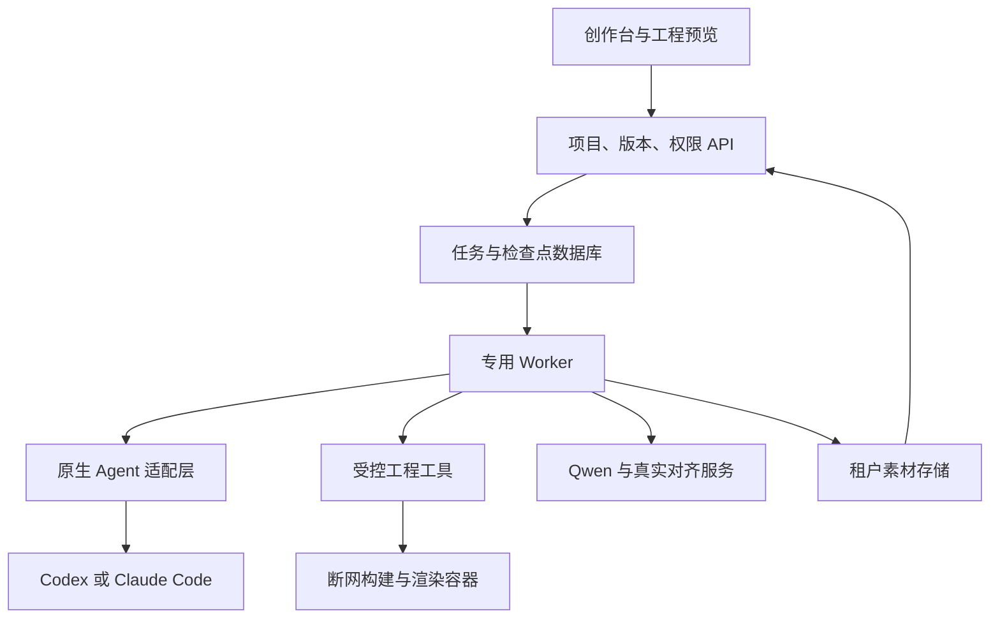
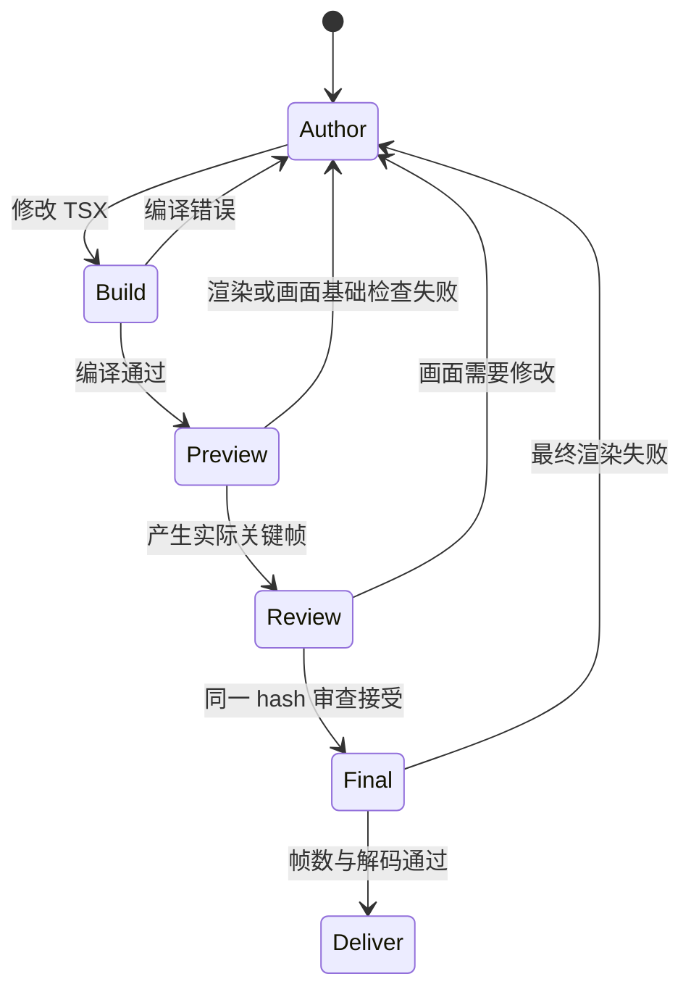

# 工程型视频 Agent：系统、领域与执行架构

## 系统职责

API 不运行模型生成代码。模型凭据仅进入对应的原生 Agent 容器；生成代码执行容器断网、无模型凭据。Worker 负责工具派发和进程清理，因此是可信控制面，需要在专用主机部署。

## 领域模型

| 模型 | 职责 |
|---|---|
| Brief | 输入、受众、语言、目标时长、引擎、制作模式和质量策略 |
| ContentIR | 来源依据、Claim/Evidence、可追溯源码快照 |
| ProductionPlan | 讲解目标、叙事结构、美术方向、声音方向、每镜头画面与动效设计 |
| StoryboardIR | 旁白、场景、资产引用；编译后包含实际帧数和字幕时标 |
| EngineeringAction | 写文件、构建、试渲染、审查、完成这五类受控操作 |
| Workspace | 实际 TSX 工程、当前 hash、检查结果和迭代日志 |
| VisualReview | 对本次真实关键帧的检查、问题和评分，不是人工认证 |
| Revision / Job / Asset | 不可变版本、带租约的任务、按租户隔离的交付物 |

## Agent 与工程能力如何协同

原生 Agent 自带推理循环、上下文与读取工具。平台提供工程任务契约，将其输出转为可审计文件编辑和工具调用：写入 TSX → tsc 与 Remotion bundle → 关键帧 → 图像审查 → 修复。平台不以关键词代替任务规划，也不把模板填充称为自由工程创作。

策划阶段先得到方案、脚本与逐镜头动效设计；配音和对齐得到实际时长后，编码阶段以精确 props 为输入。原生 Agent 能自由组织 React/SVG/CSS 动画，不能改变受控入口、渲染器、依赖或通过输出请求执行任意 shell。工具承担构建与渲染，而不是把带 API 密钥的 Bash 交给项目源码。

## 完成判据

任何源码、props 或素材变化都会使旧 build/preview/review hash 失效。审查必须列出所有本次关键帧；不能引用不存在的截图。基础像素检查能拒绝空白、错误尺寸和全程相同的画面，但不等同于内容理解。字体加载失败直接取消渲染；字幕乱码替换符和缺失字形被检查。

## 持久化与恢复

每次动作结果都记录在工作日志，并将源文件状态与关键帧资产保存到对象存储；更新输出角色时在数据库事务中检查 job fence 和 lease_owner。新 Worker 可以重建本地目录。源码 hash 不一致时旧检查不生效。

平台阶段检查点与原生内部会话不同；本版每次决策通过完整工程上下文重建，不迁移厂商内部记忆。崩溃发生在供应商请求完成、平台状态提交之前，可能重复调用并产生额外费用。取消通过 guard 与容器删除生效，不承诺瞬时撤销已发生的供应商费用。
