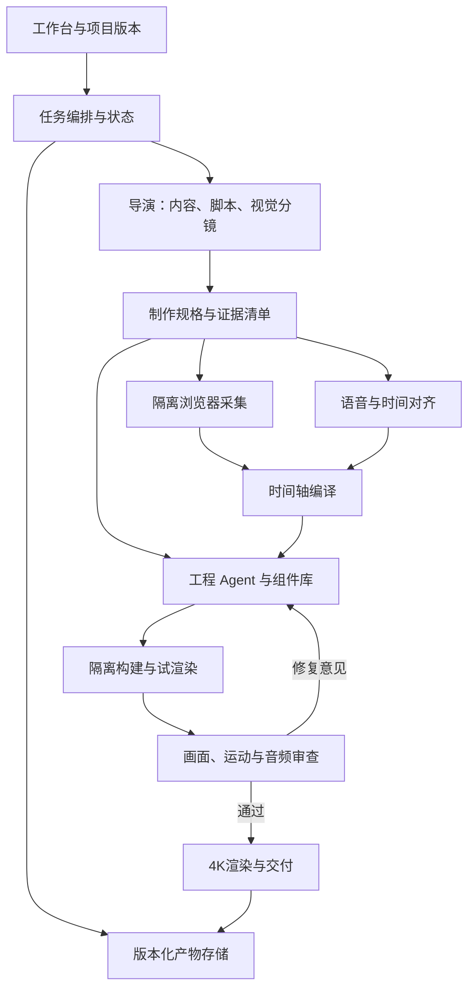

# Engineering Video Agent：视觉讲解视频工程架构与改造方案 V4

日期：2026-11-16。性质：方案与静态代码审查；不是已实施或已完成部署验收的声明。

## 1. 结论与推荐决策

推荐继续改造 `zhongyoubo/Engineering_Video_Agent`，保留其 V3 工程执行基座，将产品升级为“工程驱动的视觉讲解视频 Agent”。无需因为使用 Sites、MCP 或新视频框架而另起一套平台。

核心组合：现有 React 工作台 + FastAPI + 可替换 Codex/Claude 原生推理引擎 + 视觉导演规格 + React/SVG 动效组件 + Remotion + 可替换 TTS + 已知文本语音对齐 + FFmpeg + 隔离 Worker。

三个必须区分的目标：

1. 能运行：从真实输入得到可播放视频，并交付完整源码。
2. 能解释：内容被转成对象、关系、状态及变化，观众能理解机制。
3. 效果接近参考：构图、排版、视觉隐喻、连续运动、旁白及节奏统一，经过样片和成片审阅。

仓库已具备第一个目标的代码基础，但记录的真实环境集成验证仍有缺口；第二、第三个目标需要新增设计资产和质量闭环。单靠提示词、MCP 或提高分辨率不能保证同等效果。

本次检索没有找到经过核实、可直接覆盖“任意源码理解、真实页面演示、动态图解、自然中文讲解、4K、编辑版本与工程交付”的成熟一体化替代品。成熟程度更高的是渲染、浏览器自动化、语音等组件；相近 Agent 项目适合参考工作法，不能据 README 宣称其具备生产可靠性。

## 2. 分析依据与验证边界

### 2.1 视频依据

已上传并分析三段参考录屏：

| 参考 | 时长约 | 核心能力 | 典型表现 |
|---|---:|---|---|
| VID_20261116_230851.mp4 | 2分23秒 | 软件过程可视化 | 提示词、代码扫描、问题清单、任务关系、终端 |
| Screenrecorder-2026-11-16-23-01-52-429.mp4 | 3分06秒 | 观点与隐喻可视化 | 十卡目录、渠道网络、浅坑与深井、复利流程、日历 |
| Screenrecorder-2026-11-16-22-55-23-749.mp4 | 6分01秒 | 技术机制可视化 | 模型路由、推理分支、上下文、权限关卡、流量瓶颈 |

观察方法是全片间隔抽帧与代表性片段连续采样，不是逐帧审片或完整听感评估。不推断原作者的制作软件，不把示意图当作真实运行数据，也未认定视频技术论述全部正确。原始四个微信链接不能与三段录屏逐一可靠对应。

共同视觉特征：暖白背景、少量深色章节、黑色标题、暗红重点、柔和阴影、低饱和图形、逐步揭示、同场景内状态演进、固定字幕区，以及总览—展开—回顾的组织方式。应抽取这种方法与设计规则，使用原创文字、插画和品牌素材。

### 2.2 代码依据

审查仓库：[Engineering_Video_Agent](https://github.com/zhongyoubo/Engineering_Video_Agent)。固定基线提交：`4d46238d08dfd84ae751cb370b89fa62b9059a44`。

已读取该提交的完整文件树，以及 README、AGENTS、Roadmap、V3 验证记录、领域模型、工程控制器与工作区、规划/主流水线、语音和运行适配、原生 CLI 驱动、渲染脚本与 Root、Studio 主界面、部分测试与部署文件。

本次没有修改远程仓库、调用收费模型、安装第三方 MCP 或运行完整项目测试；没有把历史测试记录作为本次重跑结果。以下涉及运行行为的风险均为静态代码推断，实际复现应在后续实施阶段完成。

证据入口：

- [README](https://github.com/zhongyoubo/Engineering_Video_Agent/blob/4d46238d08dfd84ae751cb370b89fa62b9059a44/README.md)
- [V3 验证记录](https://github.com/zhongyoubo/Engineering_Video_Agent/blob/4d46238d08dfd84ae751cb370b89fa62b9059a44/docs/verification-v3.json)
- [工程执行设计](https://github.com/zhongyoubo/Engineering_Video_Agent/blob/4d46238d08dfd84ae751cb370b89fa62b9059a44/docs/design/engineering-agent.md)
- [工程控制器](https://github.com/zhongyoubo/Engineering_Video_Agent/blob/4d46238d08dfd84ae751cb370b89fa62b9059a44/apps/api/src/explainer/services/engineering/controller.py)

## 3. 现有项目评价：应该保留什么

现有项目已超过“填 JSON 模板出片”的阶段。工程模式允许 Agent 编写受限目录内的 TSX，平台负责写入、构建、试渲染、传递真实关键帧、审查和修复；完成条件绑定当前工程 hash。旧模板模式是兼容分支，不能将它误认作整个 V3 的能力上限。

| 现有设计 | 评价与处理 |
|---|---|
| 原生 Agent 适配层 | 保留；平台协议承载状态，避免绑定某个模型内部会话 |
| EngineeringController | 保留并扩展工具动作与审查证据 |
| Workspace 文件与 hash 门禁 | 保留；增加渲染环境、设计包和音频配置版本 |
| 无凭据、断网渲染容器 | 保留；依赖预置、素材预取，禁止无隔离回退 |
| 语音后分配实际帧预算 | 保留；继续避免截断旁白或按文字猜语音时长 |
| stable-ts 已知脚本对齐 | 保留；改造为能力检测和统一对齐接口 |
| 项目/版本/任务与租约 fencing | 保留；为局部再生成提供基础 |
| PostgreSQL/S3、Temporal 适配 | 保留；先完成真实部署验收，暂不添加另一套调度框架 |
| React Studio | 保留；新增分镜、波形、事件时间轴和对比能力 |
| 完整工程 ZIP 与运行证据 | 保留；强化版本清单和复现说明 |

历史记录中有后端 82 项、浏览器 5 项通过等结果，但 V3 明确列出：真实 Codex/Claude 推理、Docker/gVisor 执行、完整任务的新 TTS 与听感、真实推理取消与恢复、真实 PostgreSQL/S3 部署尚未完成验收。因此当前准确定位是“工程基座已实现，部分固定样例验证通过，真实端到端与参考级质量仍未验证”。

## 4. 具体改造差距与优先级

### 4.1 P0：正式闭环与契约一致性

| 问题 | 代码依据 | 影响 | 改造 |
|---|---|---|---|
| 正式端到端尚未验证 | docs/verification-v3.json | 无法用固定 fixture 证明真实 Agent 创作质量 | 分别运行真实供应商闭环，记录推理、渲染、音轨和人工审阅 |
| 多处固定 1080p/30fps | domain.py、Root.tsx、tools.py、quality.py、Studio | 改一个渲染参数无法完整支持4K | 引入 RenderProfile，贯穿合同、预览、字幕、校验和导出 |
| 方案中的动效是自由文本 | engineering/contracts.py 的 MotionShot | visual/movement 可供模型理解，但难以编辑、验证和精确同步 | 增加 SceneSpec / MotionSpec / CueAnchor |
| 动态质量仅由静帧推断 | render.mjs 每镜10%、45%、85%；controller.py审查 | 可能漏掉抖动、转场穿帮、瞬时遮挡、错误节奏 | 增加连续短片、边界帧和音画审查 |
| 文档语音策略与代码不一致 | AGENTS/README强调Qwen；Brief及preflight允许Qwen/Edge/Ming | 文档、测试与正式质量判定不一致 | 统一为“已验收的语音配置”，provider与质量分开 |
| 对齐就绪检测耦合本地模型文件 | integration.py preflight | 无法自然接入远端对齐或提供原生时间戳的服务 | 使用AlignmentProvider健康检查、能力与样本验证 |

1080p 固定点包括：`domain.py` 中的 width/height literal、工程 Root 的 Composition、`inspect_frame` 的尺寸和固定裁切区域、`inspect_video` 的媒体校验、字幕按30fps取值、Studio中的尺寸标识。需要统一修改并回归，不要仅更改最终编码。

### 4.2 P1：直接影响效果和使用体验

| 差距 | 观察 | 建议 |
|---|---|---|
| 没有成体系的图解设计包 | 有模板与任意TSX生成，未见覆盖参考视频的版本化表达库 | 增加设计 tokens、布局规则、示例镜头与组件 |
| 字幕能对齐，但动作没有语义锚点 | 现有cues主要用于字幕，movement是字符串 | 动作绑定到指定语句或词语的时间区间 |
| 工程预览缺少中间连续短片 | main.tsx工程分支展示最终视频或单张试渲染图 | 增加每镜低清MP4和全片低清预览 |
| 原生MCP入口受限 | driver.py对Claude显式设置空mcpServers与只读工具 | 经平台代理或白名单工具桥接；不能假设外部配置自动生效 |
| 实际运行与分镜衔接较粗 | pipeline.py先策划，再运行并插入observed_run | 改成先勘探、确定证据，再按镜头采集和绑定；变更后重校验 |
| 章节与镜头混在一层 | StoryboardIR与ProductionPlan最多16场景 | 增加chapter/shot层级，长视频按章节规划与生成 |
| TTS配置传播不足 | voice_direction存在，Qwen请求主要传text/language | VoiceSpec贯穿provider、模型、声音、风格和速度 |
| TTS缓存配置不完整 | cache_key没有显式包含edge_voice、Ming模型/端点、完整VoiceSpec | 改用规范化有效语音配置与参考音频hash生成缓存键 |
| 人工“锁镜头”不等于画面不变 | 共享TSX会影响其他镜头，文档也注明此限制 | 增加依赖图、影响范围提示、旧镜头回归帧 |

缓存问题是静态推断：改变声音配置后，在相同文本/语言和现有缓存条件下，可能复用旧音轨。应增加真实或可控适配器回归验证，不将其描述为已经在用户环境复现。

运行插镜还有一致性风险：ProductionPlan已为原场景生成shots，之后插入运行镜头，可能使方案与实际board不一致；原来16场景时再插入一个也可能超过合同上限。应在运行证据绑定后统一重建并校验有效制作规格。

### 4.3 P2：提高规模与效率

在样片质量稳定后再做：多租户协作、镜头级渲染缓存、长片分章节执行、可检索素材库、更多项目Runner、复杂三维场景、自动参考视频解析。不要先建设庞大的插件市场或全面非线性剪辑器。

## 5. 产品范围与输入输出

### 5.1 输入

- 自然语言主题：目标、受众、时长、比例、语言、需要强调的观点。
- 源码：Git仓库或归档、固定commit、启动说明、测试数据、允许演示的功能。
- 资料：Markdown、截图、架构图、文档和已有视频素材。
- 风格参考：参考片段与风格说明；提取可复用表达方法。
- 品牌包：Logo、字体、配色、片尾、字幕样式。

输入模式应显式区分：concept_explainer、technical_explainer、product_demo、hybrid。纯提示词只能提供概念与模拟演示；真实功能必须由运行证据支撑。

“通用”指共用流水线、模型和接口，不等于所有项目自动零配置启动。先声明支持静态Web、常见Node Web、Python API/CLI等适配范围；缺少后端、账号或依赖时提供明确受阻原因。

### 5.2 输出

最终MP4、完整旁白WAV、SRT/VTT、脚本、分镜与场景规格、设计包引用、可独立编辑的Remotion工程、素材与许可清单、运行日志、质量报告及版本差异。

必须记录实际提供商、模型与声音版本、对齐方法、渲染参数、源码/素材hash；交付工程不包含API密钥。

## 6. 目标架构



这是逻辑职责划分，初期不要求每框成为独立微服务。保留现有FastAPI模块化服务和Worker部署方式即可。

### 6.1 Agent、Harness、Runtime、Skill与MCP的职责

| 层 | 本项目职责 |
|---|---|
| 原生Agent引擎 | 理解任务、规划下一步、提出源码修改与审查意见 |
| 平台Harness | 输入上下文、任务协议、工具边界、证据、预算、恢复与验收 |
| 执行Runtime | 在隔离环境启动CLI、浏览器、编译器和渲染进程 |
| Skill | 分镜、视觉表达、Remotion、中文讲解、审片的工作方法 |
| Tool/API | 执行编译、截图、语音、渲染、检查等具体动作 |
| MCP | 将工具暴露给兼容Agent的协议入口 |
| Temporal/任务Worker | 长时间任务的持久执行、重试与恢复 |

推荐一个Director维护全片规格，按阶段使用策划、视觉、工程、音频、审查等角色指令。它们初期可以是同一引擎的不同任务，不必部署为多个自治Agent服务。后续需要时再并行独立镜头。不要叠加LangGraph来重复管理现有Temporal与Workspace状态。

Codex和Claude切换以任务、场景规格、源码、日志和产物为可移植状态；不能承诺迁移供应商内部推理状态。现有容器API-key路径不自动等同于用户订阅登录，应保持明确说明。

## 7. 制作流程与质量门禁

| 阶段 | 输入与动作 | 持久产物 | 通过条件 |
|---|---|---|---|
| 0 环境检查 | 检查源码/资源/服务/字体/磁盘 | capability-report.json | 所需能力可用，或明确受阻 |
| 1 内容理解 | 提取事实、卖点、概念和依据 | content-ir.json | 事实有来源，推断有标识 |
| 2 创意策划 | 叙事结构、章节、视觉方向 | creative-plan.json | 主线明确，符合受众与预算 |
| 3 视觉分镜 | 对象、关系、状态、构图及动作 | scene-specs、styleframes | 画面确实解释内容 |
| 4 代表样片 | 选一个高难镜头，配真实语音 | sample.mp4、review | 方向与质量达到项目目标 |
| 5 真实采集 | 按演示计划启动、操作和录制 | captures、trace、assertions | 每项成功有实际观测 |
| 6 配音对齐 | 试听配置、分段TTS、对齐 | audio、alignment、peaks | 发音与自然度可接受 |
| 7 时间轴编译 | 对齐动作、旁白与镜头 | timeline.json | 无越界、缺锚点或时间冲突 |
| 8 工程制作 | 写TSX、编译、试渲染、修复 | source、logs、preview-clips | 当前hash全部门禁通过 |
| 9 全片预览 | 检查章节、连续动作和音画 | preview.mp4、review | 全片节奏与内容通过 |
| 10 正式交付 | 4K渲染、媒体与交付检查 | final.mp4、project.zip、QA | 与当前规格和来源完全匹配 |

浏览器环境勘探可以提前到内容理解阶段；正式采集应在分镜明确后执行。TTS与素材制作可在脚本和视觉方向稳定后并行，最终时间轴必须依据实际音轨重编译。

默认只在脚本/分镜、代表样片、全片预览三个有价值的节点提供审阅；不要求每个工具调用人工确认。用户可以选择自动推进，但自动审查通过与人工认可分别记录。

当时长放不下旁白时，优先精简和重写脚本，再调整停顿与镜头，最后才在允许范围轻微变速。不得硬截音频。

## 8. 视觉设计与动态图解系统

### 8.1 设计包

新增版本化DesignPack：字体及授权、字号层级、配色、间距、圆角、阴影、字幕、布局、安全区、动效曲线、转场与示例帧。

初始提供两个原创设计包：

- editorial_warm：暖白、深绿、暗红、衬线标题，适合参考片的知识讲解。
- workspace_tech：匹配海外软件智能工作台品牌，适合真实页面、Agent架构和产品演示。

不要仅通过accent枚举换颜色。镜头内字体、图标、线条、布局和动效需要共同受设计包约束。标题字体与正文分别选择；字体文件及中英文字形覆盖一并验收。

### 8.2 三层复用

| 层级 | 示例 | 用法 |
|---|---|---|
| 基础元件 | 标题、卡片、图标、代码、节点、连线、曲线、遮罩 | 提供稳定排版与帧驱动动画 |
| 表达模式 | 对比、因果、累积、扩散、筛选、闭环、瓶颈、深入 | 根据要解释的关系选择 |
| 定制镜头 | 特殊视觉隐喻、品牌化场景、复杂机制 | Agent在受控目录自由编写TSX |

现有“Agent自由写TSX”必须保留，组件库作为可靠积木与审美基准，而非新的固定模板上限。

### 8.3 首批十二类场景

1. CardOverview：弧形目录、章节选择、矩阵回顾。
2. QuoteExplain：引用材料、出处、中文解释与重点。
3. CodeScan：代码扫描、行高亮、问题清单。
4. SplitCompare：左右对照、参数与结果差异。
5. GraphFlow：架构节点、路由、调用与状态流动。
6. CapacityStack：上下文、容量、堆叠与污染标记。
7. QueueBottleneck：请求进入、排队、限流与恢复。
8. DepthMetaphor：浅坑、深井、深度积累等隐喻。
9. TimelineCalendar：里程碑、日历、版本迭代。
10. MetricChart：真实数据图或明确标记的示意趋势。
11. BrowserWalkthrough：真实页面、操作提示与局部聚焦。
12. ClosingSummary：结论、价值、品牌片尾。

每类至少有：组件接口、输入示例、中文样例、边界样例、预览片、失败例和说明。首期先完成六类覆盖主要镜头，其余递增。

### 8.4 “抽象内容→画面”算法

1. 提取此段观众必须理解的一句话。
2. 找到对象、关系和变化，判断是对比、因果还是流程等。
3. 为关键镜头提出两个视觉候选，说明哪个更直接。
4. 确定构图与阅读顺序，避免同时展示过多信息。
5. 绘制关键状态A/B/C，再定义它们之间的连续变化。
6. 将变化绑定到旁白对应短语。
7. 用样片检查观众能否脱离大段文字理解要点。

不能做简单关键词到模板匹配。比如“记忆”可能解释信息来源、检索、生命周期或干扰，应该按讲解目标选择不同表达。

### 8.5 连续性与节奏

使用稳定的element_id承载跨状态身份；章节目录卡进入详情时可复用同一身份。建立镜头起始、解释、强调、结论、退出几个阶段。动画有阅读停留时间，长标题先压缩文案再布局。

精确文字与图解优先SVG/React。大量粒子可用Canvas；只有明确需要空间结构时才增加Three.js。所有随机效果固定种子，所有动画从当前帧和规格推导，禁止依赖墙钟时间与累积状态。

## 9. 制作规格与数据模型

### 9.1 推荐对象

| 对象 | 关键字段 |
|---|---|
| Project / Revision | 输入、父版本、目标、状态、内容hash |
| Chapter | 叙事目标、章节顺序、镜头引用 |
| Shot / SceneSpec | 讲解目标、旁白、对象、关系、关键状态、布局、证据 |
| MotionSpec | 动作、目标元素、时间锚点、持续时间、缓动、前后状态 |
| CueAnchor | 文本区间、对应音频、实测起止、置信度、人工调整 |
| VoiceSpec | provider、model、voice、语言、风格、速度、参考音频hash |
| RenderProfile | 宽高、fps、逻辑画布、安全区、编码与预览规格 |
| Asset | 内容hash、来源、许可、尺寸、字体覆盖、派生关系 |
| Review | 类型、时间码、问题、证据、评分、模型/人工身份 |
| ArtifactManifest | 当前源码、props、素材、设计包、环境、音轨和产物hash |

状态轴分开记录：execution_state（排队/运行/成功/失败/取消）、verification_state（已实现/未验证/受阻）、review_state（待审/修改/通过）。成功编码不等于已人工验收。

### 9.2 动效事件示例（提议合同，不是现有API）

```json
{
  "schema_version": "4.0",
  "shot_id": "queue_limit",
  "purpose": "解释请求增加时为何出现排队",
  "evidence_mode": "illustrative",
  "design_pack": "workspace_tech@1",
  "narration_segment_id": "speech_008",
  "elements": [
    {"id": "incoming", "type": "request_stream"},
    {"id": "gateway", "type": "capacity_gate"},
    {"id": "queue", "type": "queue"}
  ],
  "states": ["normal", "busy", "limited"],
  "events": [
    {
      "id": "requests_grow",
      "target": "incoming",
      "action": "set_rate",
      "value": 18,
      "unit": "illustrative_particles_per_second",
      "anchor": {"cue_id": "cue_requests_increase", "offset_ms": -150},
      "duration_ms": 900
    },
    {
      "id": "show_limit",
      "target": "gateway",
      "action": "set_state",
      "value": "limited",
      "anchor": {"cue_id": "cue_concurrency_limit", "offset_ms": 0},
      "duration_ms": 400
    }
  ]
}
```

编译器验证cue存在、元素存在、动作兼容、事件不超出镜头、锚点无歧义。缺失锚点需要报错或返回待修复，不能静默按比例猜时间。语速变化后重新计算frame，无须模型重写所有动画。

### 9.3 RenderProfile

建议逻辑画布先统一1920×1080，预览输出1280×720，正式输出3840×2160；SVG与文字以目标分辨率渲染。输出缩放参数纳入hash，截图源素材必须有足够清晰度。竖屏9:16使用独立布局规则，不把横版直接裁成竖版。

全链路用profile.fps，不再散落`/30`。字幕区和采样裁切使用归一化安全区。若首期只支持30fps，应明确限制，但数据模型预留扩展。

## 10. 语音、对齐与混音

### 10.1 语音策略

正式质量由已验收VoiceProfile决定，而不是provider名字决定。默认偏好专业播报讲解、男声、普通话自然，先用包含中文、Agent/Jira/API缩写、数字与长句的样本文本盲听选择。

| 路线 | 用途 | 约束 |
|---|---|---|
| 自部署Qwen3-TTS | 复用现有服务，控制声音与部署 | 需要权重、GPU/性能测试和模型校验 |
| CosyVoice | 中文替代路线候选 | 单独做质量及部署验证，非无成本替换 |
| 官方云端TTS API | 无本地权重时优先打通真实闭环 | 账号、地域可用性、成本及声音试听 |
| ElevenLabs托管MCP/API | Agent调用和语音候选 | 接入权限与费用；普通话效果需项目样本验证 |
| 当前Edge适配 | 开发或明确选择的候选音色 | 代码使用edge_tts读 aloud路径，不能等同Azure正式服务承诺 |
| eSpeak/无声 | 显式草稿、测试 | 不得悄悄替代正式配音 |

Qwen官方支持声音控制及本地权重准备，但选定模型与声音是否满足本项目，需要真实试听。权重下载失败时选择显式批准的替代配置，记录实际provider；禁止静默降级。

### 10.2 音频流程

按语义段合成，避免中文逐字拼接。术语使用发音词典；音色、风格、采样率在全片稳定。保存原始音轨和处理后音轨。

现有voice.py已执行highpass与loudnorm，不能再将“完全没有响度处理”列为问题。下一步是测量处理后的实际结果、全片混音后再次校验，并记录LUFS、true peak和静音区间。

建议项目初始目标：旁白总响度约-16 LUFS、真峰值不高于-1.5 dBTP；这属于可调工程基线，不是所有平台的强制标准。背景音乐低于旁白，使用ducking；参考片不需要大量音效堆叠。

### 10.3 对齐

已知旁白脚本：优先用原生可靠时间戳或stable-ts对齐已知文本。未知音频：先ASR，再校正文本并对齐。对齐只确定时间，不修复错误发音；ASR回译相符也不保证播音自然或专业词正确。

先完成语速与停顿调整，再做最终对齐。若后续变速，必须更新所有cue和动作锚点并重新验收。提供波形、字幕与事件标记联动，以及用户拖动微调能力。

### 10.4 缓存

缓存键使用规范化JSON的hash，至少包含有效文本、language、provider/model/version、voice_id、style、speed、reference_audio_hash、发音词典版本、采样设置、后处理版本。音频发生变化时使alignment和timeline失效；视觉改动不使音频失效。

## 11. 真实页面与项目执行

保留隔离Runner；开发阶段可用Playwright MCP或CLI勘探页面，正式采集优先回放版本化Playwright脚本，减少每次依赖模型找按钮的随机性。

DemoPlan包含：启动适配器、入口、viewport、测试数据、动作、等待条件、断言、采集区、敏感信息遮罩与证据输出。

典型流程：负责人首页→AI项目状态→项目计划→工程师首页→Jira分析。每段必须等待真实响应条件，例如卡片出现、请求完成或对应文字可见，而非固定长时间sleep。鼠标聚焦、点击提示和局部放大由后期合成，保持页面比例。

页面真实输出、概念示意和测试数据分别标记。只有截图不足以证明交互成功；应保留操作记录、断言、必要的网络/控制台摘要。页面字体和字符编码检查与最终成片检查分开。

## 12. GitHub可复用方案与选型

核验日期2026-11-16；下表是源码/文档检索与能力匹配，不是本次部署压测。成熟度判断综合职责清晰度、官方维护、使用范围及本次可见项目情况，不以star单独下结论。

| 项目 | 层次与可借鉴内容 | 建议 |
|---|---|---|
| [remotion-dev/remotion](https://github.com/remotion-dev/remotion) | React视频渲染、服务端工具和Player | 主引擎，继续复用 |
| [remotion-dev/skills](https://github.com/remotion-dev/skills) | 官方Agent工程方法与API使用规范 | 选取需要的内容固定版本后纳入原生运行镜像 |
| [microsoft/playwright-mcp](https://github.com/microsoft/playwright-mcp) | 官方浏览器操作MCP | 勘探与交互调试；正式任务回放脚本 |
| [motion-canvas/motion-canvas](https://github.com/motion-canvas/motion-canvas) | TypeScript向量动画与语音同步 | 借鉴状态演进；暂不替换主引擎 |
| [ManimCommunity/manim](https://github.com/ManimCommunity/manim) | 数学、算法与科学动画 | 作为特定镜头可选离线素材生成器 |
| [QwenLM/Qwen3-TTS](https://github.com/QwenLM/Qwen3-TTS) | 自部署语音基础组件 | 复用现有适配并补真实验证 |
| [QwenAudio/CosyVoice](https://github.com/QwenAudio/CosyVoice) | 中文语音候选 | 音频A/B测试后决定是否接入 |
| [jianfch/stable-ts](https://github.com/jianfch/stable-ts) | 已知文本强制对齐 | 保留现有路线 |
| [Daniel-Goatman/MotionExplainer](https://github.com/Daniel-Goatman/MotionExplainer) | 分镜先行、章节参考帧、带配音代表样片 | 高度相关的流程参考，但仓库很早期，本次可见只有1条提交；未见明确许可，应先确认后复用代码 |
| [DojoCodingLabs/remotion-superpowers](https://github.com/DojoCodingLabs/remotion-superpowers) | 素材、音频、审片技能与工具编排 | 社区参考，按模块吸收；注意Node版本和外部服务依赖 |
| [mcp-use/remotion-mcp-app](https://github.com/mcp-use/remotion-mcp-app) | 聊天内编译、Player预览及增量修改 | 借鉴MCP App交互，不能替代隔离渲染和质量系统 |

MotionExplainer的推荐模型属于作者自身经验，不能当作本项目Codex/Claude客观排名；使用同一批脚本、预算与评审标准做自己的A/B测试。

Remotion不是一律免费且无条件的MIT基础库；企业视频自动化场景应在上线前核对官方当前授权。其他仓库、字体、权重、插画分别记录许可；第三方项目代码许可不自动覆盖其依赖、声音和素材。

明确不推荐：为了参考片效果同时接入多套主动画引擎；用普通短视频“素材拼接+字幕”项目替换现有工程Agent；把社区README的production-ready描述直接当验收证据。

## 13. MCP与Skill接入方案

### 13.1 当前可核实的选项

| 选项 | 当前情况 | 接入建议 |
|---|---|---|
| Remotion官方托管MCP | 官方公告2026-10-26已关闭 | 使用官方Skills与/remotion-docs，不使用旧MCP地址 |
| Playwright MCP | 微软维护、提供浏览器自动化 | 首选浏览器工具候选 |
| ElevenLabs官方MCP | 本地旧仓库已弃用，转托管OAuth服务 | 可用于TTS候选；使用当前托管文档而非旧安装指南 |
| mcp-use Remotion MCP App | 社区代码与实时Player交互方案 | 自部署试验，验收编译边界、会话、稳定性和许可 |
| 自有Video MCP | 本项目尚需实现 | 把现有API/Worker包装成稳定工具，是推荐主控制入口 |

当前对话未连接并执行上述视频/TTS MCP；“查到可接入”不等于“当前已经可以调用并通过验收”。

### 13.2 本项目为什么不能直接加配置就用

`services/native_agent/driver.py` 中Claude路径显式使用严格空MCP配置，工具仅开放只读；现有工程动作由平台根据结构化结果调度。这是有意义的边界。不要简单删除限制、把任意MCP和供应商密钥交给生成代码。

推荐两层：

1. 原生引擎仍返回受控动作，平台ToolGateway执行浏览器、音频及渲染服务。固定依赖和认证在网关/服务端。
2. 需要外部Codex/Claude直接驱动平台时，由自有MCP服务器将同一批应用服务暴露出去；API、UI、MCP共用任务状态和产物，而非三套逻辑。

### 13.3 建议的自有MCP工具

以下是提议命名，非现有工具声明：

| 工具 | 作用 | 执行形式 |
|---|---|---|
| video_create_project | 建立项目与输入 | 快速返回project_id |
| video_get_capabilities | 检查模型、字体、TTS、Runner | 返回状态和阻塞项 |
| video_plan | 生成/更新制作规格 | 异步job_id |
| video_render_sample | 指定镜头与版本试渲染 | 异步job_id |
| video_synthesize | 使用VoiceSpec生成音轨 | 异步job_id |
| video_review | 审查指定片段与当前hash | 异步job_id |
| video_render_final | 渲染最终规格 | 异步job_id |
| video_get_job | 查询阶段、进度和错误 | 快速读取 |
| video_get_artifacts | 获取产物与短效访问入口 | 快速读取 |
| video_cancel_job | 请求取消并清理执行进程 | 异步状态 |

MCP调用传project_id、revision_id、shot_ids、profile与idempotency_key；长任务不保持一次工具调用等待数十分钟。禁止通用任意shell工具，工具结果引用产物不返回巨量base64。返回证据与错误码，保留用户/项目权限边界。

### 13.4 Skills

建议内置五类工作方法：content-research、visual-direction、motion-authoring、mandarin-narration、video-review，再结合官方Remotion方法。版本化保存、按阶段加载，并在产物清单中记录版本。外部仓库的AGENTS、hooks与MCP配置继续作为不可信输入，不自动执行。

## 14. 工作台交互

保留现有React/Vite实现。即使海外工作台采用Vue，也不必将视频编辑核心整体重写；可以独立应用或受控页面集成。若选Sites，只承担入口/管理或轻量API代理，重渲染、原生CLI和自部署模型继续在外部Worker；本次不创建重复的Sites工程。

建议六个工作区：

1. 项目与输入：源码、主题、品牌、目标与环境检查。
2. 内容与脚本：章节、事实依据、旁白与发音词典。
3. 视觉分镜：静态构图、关键状态、组件选择与设计包。
4. 时间轴：旁白波形、字幕、镜头、事件、转场和锁定。
5. 预览与比较：逐镜短片、全片、A/B版本、关联问题。
6. 运行与交付：任务日志、阻塞项、验收、源码及文档。

先做轻量事件编辑，不从零复刻Premiere。支持修改事件时间、换场景组件、局部再生成、调整旁白段落，以及查看受影响镜头。波形由实际音频离线计算peak数据，不绘制装饰性假波形。

工程预览第一阶段继续使用真实渲染MP4，避免在主站直接执行任意生成JS；后续需要交互Player时，在独立无凭据域/严格沙箱中提供，评估postMessage与资源隔离。不能为了实时预览破坏现有隔离边界。

版本比较至少展示：脚本差异、VoiceSpec差异、场景/事件差异、关键帧对比与时间同步播放。局部锁定显示实际保证范围；共享组件变化必须提示并触发关联镜头回归。

## 15. 工程目录与模块调整

保留现有目录并渐进新增：

| 路径 | 调整 |
|---|---|
| apps/api/src/explainer/domain.py | Chapter、Shot、VoiceSpec、RenderProfile与新状态 |
| services/engineering/contracts.py | SceneSpec、MotionSpec、CueAnchor及严格校验 |
| services/engineering/agent.py | 分离创意/视觉/工程/审查上下文 |
| services/engineering/controller.py | 连续预览、音频审查与复审动作 |
| services/engineering/tools.py | profile驱动的渲染、短片与测量 |
| services/engineering/workspace.py | 依赖清单、哈希、受影响镜头与导出 |
| services/pipeline.py | 先绑定运行证据，再冻结有效制作规格；阶段职责拆分 |
| adapters/voice.py | Provider接口、VoiceSpec、缓存与能力检测 |
| services/timeline.py | cue驱动事件编译与冲突检查 |
| services/quality.py | 区分静态、动态、音频、媒体与人工审查 |
| services/native_agent/driver.py | 受控工具桥与Skills装载配置 |
| packages/contracts/ | Schema/OpenAPI升级与旧版迁移 |
| packages/design-system/（新增） | tokens、字体、布局、示例与设计包 |
| packages/motion-kit/（新增） | 基础动画、语义场景、组件示例 |
| packages/engineering-template/ | 引用上述包、可信Root、RenderProfile |
| services/mcp/（新增） | 自有MCP薄适配层，调用同一应用服务 |
| apps/studio/src/features/（新增） | 从main.tsx逐步拆出script/storyboard/timeline/review模块 |
| examples/reference-patterns/（新增） | 原创重建的参考表达样片 |
| tests/golden/（新增） | 视觉、同步与局部修改验收集 |

受控依赖策略：当前工程模板只预置React/Remotion等少量依赖。新增motion-kit、字体、SVG工具等需要更新锁文件与渲染镜像，由平台安装和打包，不允许生成代码在运行中任意npm install。

## 16. API、任务与存储合同

保留v1/v3兼容语义，新增能力用明确版本或扩展端点。以下为提议设计，实施时先核对现有OpenAPI避免冲突：

| API | 职责 |
|---|---|
| POST /api/v4/projects/{id}/revisions | 创建有明确输入与父版本的新版本 |
| POST /api/v4/revisions/{id}/plan | 生成或更新内容与视觉规格 |
| PATCH /api/v4/revisions/{id}/shots/{shot} | 修改镜头，返回影响范围与新hash |
| POST /api/v4/revisions/{id}/voice-samples | 生成试听 |
| POST /api/v4/revisions/{id}/preview | 镜头/章节/全片低清渲染 |
| POST /api/v4/revisions/{id}/render | 正式输出 |
| POST /api/v4/jobs/{id}/cancel | 请求取消 |
| GET /api/v4/jobs/{id}/events | 实际事件流 |
| GET /api/v4/revisions/{id}/compare?base={other} | 结构与产物差异 |

长任务返回202及job_id；事件包含阶段、动作、实际进度、耗时、错误与产物引用。用户修改不能悄悄覆盖运行中的规格，应产生版本或使任务明确失效。

任务预算至少包含模型花费上限、动作次数、工具超时、渲染并发、磁盘和产物保留。重试要区分可恢复网络错误、确定性编译错误和质量不通过；保留租约防护与取消清理。

内容寻址缓存：scene_source_hash + props_hash + asset_hashes + design_pack_version + renderer_image_digest + render_profile。全局风格或共享组件变化使相关镜头失效；仅字幕变更可复用无字幕底片，但最终合成仍需验证。

## 17. 验收：怎样判断达到参考效果

### 17.1 自动硬检查

| 类别 | 建议验收目标 |
|---|---|
| 资源 | 压缩包可解压、文件hash匹配、字体可加载、音视频可解码 |
| 输出 | 正式横版3840×2160、约定fps、正确音轨与完整帧数 |
| 文字 | 无替换字符；必要字形覆盖；关键文字在安全区；字幕不越界 |
| 时间 | 事件和cue合法；无非预期空洞；完整旁白不截断 |
| 画面 | 无非预期黑帧/白帧；场景边界及事件前中后抽查 |
| 声音 | 实测响度/峰值报告；非预期静音被标记；字幕与音轨同版本 |
| 证据 | 真实演示声明均有关联的运行观测与断言 |
| 复现 | 当前hash工程可安装、编译、预览与重渲染 |

静止场景和有意留白不能简单判作失败；检查需要根据场景意图解释异常。

### 17.2 动态和听感评审

在动作开始前、进行中、结束后及转场两侧取帧；为复杂镜头提供完整连续短片，不能仅凭三张静帧判定运动流畅。音画同步抽样建议以关键cue误差约200ms以内作为初始目标，最终阈值由标注样本校准。

人工/独立评审按1–5分评价：内容准确、讲解清晰、构图排版、视觉一致性、运动连续性、语音自然度、音画节奏。建议各项至少4分且无严重问题作为项目基线；这是一套拟定验收标准，不是系统已经达到的结果。

不能仅依赖作者模型自评分。采用规则检查 + 独立审查调用 + 人工完整观看/试听三层证据，分别标识。

### 17.3 首批验收样片

| 样片 | 长度建议 | 核心验证 |
|---|---:|---|
| 代码扫描与问题清单 | 15–20秒 | 代码可读、扫描与发现同步 |
| 浅坑与深井 | 15–20秒 | 隐喻、状态变化和旁白对应 |
| 请求汇聚与限流 | 15–20秒 | 粒子确定性、瓶颈清晰、连续流畅 |
| 工作台真实交互 | 20–30秒 | 操作、响应等待、证据与局部聚焦 |
| 混合讲解片 | 60–90秒 | 图解与真实界面之间的风格统一 |

先用这些固定输入建立自己的质量基线，再扩展到3–6分钟全片。不要将“一次成功生成”当成稳定能力；建议对至少两种引擎、多个主题与重复运行记录成功率、修复次数、成本和人工修改时间。

## 18. 实施路线与工作量

以下为工程估算，不是承诺；以现有代码可构建、服务凭据可用和熟悉React/Python的开发者为前提，环境与供应商故障可能增加时间。

| 里程碑 | 工作 | 交付与退出条件 | 粗估人日 |
|---|---|---|---:|
| M0 真实基线 | 冻结提交、部署Worker、跑真实Agent/TTS/对齐、记录失败 | 一段真实带配音样片及完整日志 | 3–5 |
| M1 规格与4K | RenderProfile、VoiceSpec、状态轴、缓存修复、合同兼容 | 1080p与4K回归通过 | 5–8 |
| M2 视觉能力 | 设计包、Scene/Motion/Cue规格、六类组件、三段参考表达样片 | 人工确认构图与连续动画 | 8–12 |
| M3 完整制作 | 真实采集绑定、音画事件、全片预览、动态/音频评审 | 60–90秒混合片通过 | 6–10 |
| M4 工作台 | 波形、轻量时间轴、版本对比、局部再生成 | 编辑结果可追溯并正确失效 | 6–10 |
| M5 MCP与加固 | 自有工具桥、幂等、恢复与受控外部接入 | 外部Agent驱动同一任务闭环 | 3–5 |

合计约31–50人日。单人全职约6–10周，视视觉设计经验和部署环境调整；两人可部分重叠，但不等于工期直接减半。先获得可靠的30–60秒样片通常不需要等全部里程碑完成。独立视觉设计/配音复核投入应计入计划。

主机初始规划建议：Linux/WSL2开发；隔离渲染Worker从8核/16–32GB内存做实际benchmark，4K并发从1开始；本地TTS GPU按具体模型、精度和实测显存决定。使用云端TTS时不要求本地GPU。最终容量以项目样片的帧耗时、峰值内存和成本为准。

## 19. 首批可执行改造任务

1. 创建基线验收记录：源码commit、镜像digest、模型版本、样片、日志、实际未验证项。
2. 修复语音配置缓存键；统一正式配音策略与文档。
3. 引入RenderProfile，移除关键路径上的固定1080p和散落30fps。
4. 增加Chapter/Shot与SceneSpec/MotionSpec/CueAnchor，提供v3迁移器。
5. 创建两个DesignPack和首批六类motion-kit组件。
6. 让代表性镜头先渲染连续带声样片，再批量制作。
7. 增加render_preview_clip、review_motion、review_audio等受控动作。
8. 将真实运行产物绑定到指定镜头，重新校验最终制作规格。
9. 新增waveform-peaks和事件时间轴，保持工程预览隔离。
10. 封装自有Video MCP，复用已有应用服务。
11. 补充黄金样例、变更影响测试、取消恢复与真实服务验收。
12. 同步AGENTS.md、Roadmap.md、README.md及设计/接口/部署文档，保留明确的验证边界。

测试聚焦有意义的不变量：修改声音必换音轨；修改音轨必重编时间轴；改共享组件触发关联复审；4K不能通过1080p硬编码校验；新产物不能复用旧审查；运行插镜后合同仍一致；取消后容器被清理且陈旧Worker不能提交。

## 20. 建议的工程施工提示词

> 在Engineering_Video_Agent现有V3基线上实施视觉讲解视频V4。先读取当前AGENTS、README、Roadmap与设计，不将fixture通过当作真实服务验收。保留原生Agent可替换、受控TSX生成、隔离构建渲染、版本hash门禁、租约取消与完整工程导出。
>
> 第一批完成真实基线、VoiceSpec缓存与策略统一、RenderProfile端到端4K、SceneSpec/MotionSpec/CueAnchor，以及六类原创动态图解组件。自由TSX创作保留，组件库作为可靠基础。制作代码扫描、深度隐喻、并发瓶颈三个带真实旁白的连续样片。
>
> 之后补充真实浏览器镜头绑定、全片低清预览、动作/音频独立审查、轻量时间轴、波形、版本对比及自有MCP工具桥。所有工具复用同一任务服务，外部模型凭据不进入生成代码容器。
>
> 每个里程碑提供源码、命令、日志、样片、实际检查结果及未验证项。自动验收与人工审片分开。优先保证观众能理解的视觉表达和自然中文旁白，不用模板成片、假波形、假进度或模型自评替代真实证据。

## 21. 官方资料与参考链接

以下资料在本次任务中检索或读取。项目能力以其文档为依据，本次未部署第三方项目验证。

1. Remotion服务端渲染：https://www.remotion.dev/docs/renderer/render-media
2. Remotion Player：https://www.remotion.dev/docs/player
3. Remotion Agent Skills：https://www.remotion.dev/docs/ai/skills
4. Remotion官方MCP停用公告：https://www.remotion.dev/docs/ai/mcp
5. Remotion授权：https://www.remotion.dev/docs/license/pricing
6. Playwright MCP：https://github.com/microsoft/playwright-mcp
7. Motion Canvas：https://github.com/motion-canvas/motion-canvas
8. Manim：https://github.com/ManimCommunity/manim
9. Qwen3-TTS：https://github.com/QwenLM/Qwen3-TTS
10. CosyVoice：https://github.com/QwenAudio/CosyVoice
11. stable-ts：https://github.com/jianfch/stable-ts
12. MotionExplainer：https://github.com/Daniel-Goatman/MotionExplainer
13. Remotion Superpowers：https://github.com/DojoCodingLabs/remotion-superpowers
14. Remotion MCP App：https://github.com/mcp-use/remotion-mcp-app
15. ElevenLabs旧MCP弃用说明：https://github.com/elevenlabs/elevenlabs-mcp
16. ElevenLabs托管MCP：https://elevenlabs.io/docs/eleven-agents/operate/hosted-mcp
