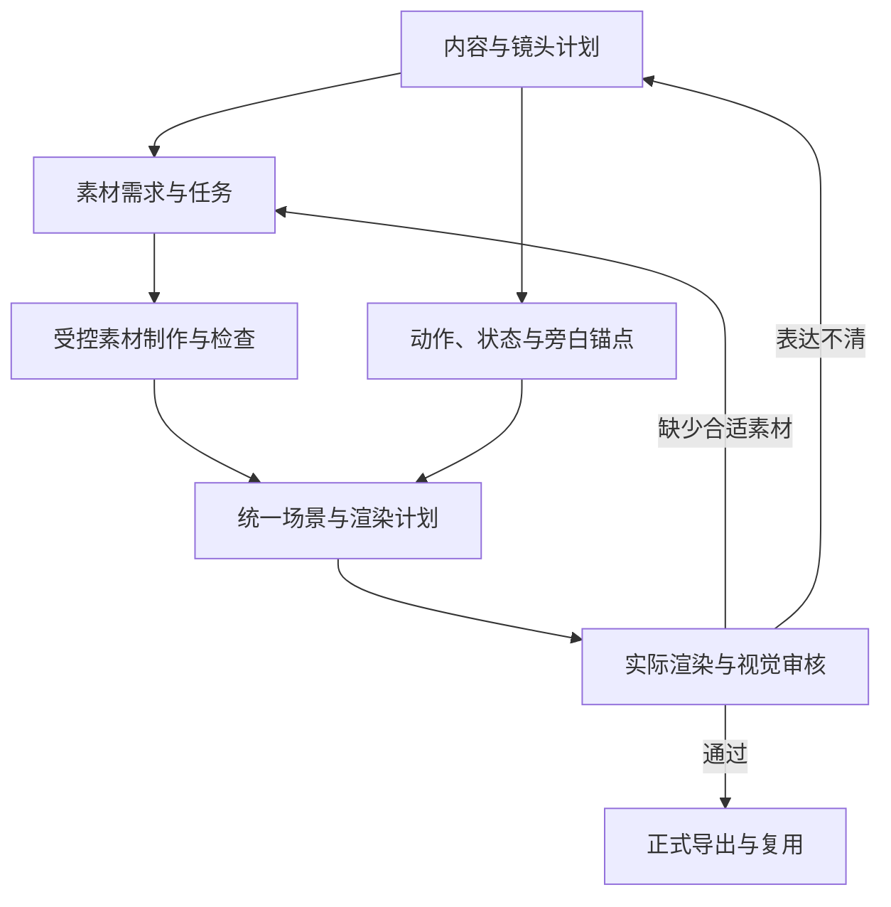

# Engineering Video Agent：场景理解、素材制作与语义动效优化方案

版本：V5 设计提案（不是已发布功能）
日期：2026-11-18
目标：输入主题、资料或项目源码后，Agent 能围绕表达目的设计镜头，获取或制作合适的素材，编排可理解的动作，并依据实际画面修正后交付。

## 1. 审查结论与基线

当前最主要的缺口在“理解表达目的”到“制作具体画面”之间。已有内容策划、Remotion 工程编写、构建/预览/审核、TTS、真实旁白锚点与导出基础；应在这些基础上增加结构化视觉计划、可调用素材制作工具、可组合场景和因果审核。

不需要为此替换原生 Agent、另建一套 Agent Runtime 或引入新的流程框架。策划、美术、执行与审核可以先作为同一 Agent 的不同阶段，以版本化任务和受控工具连接。

### 1.1 本轮实际检查的版本

- 远端 main：`fcf44378069e7c3e22d4d785e3c60210f49e6d17`。
- 对象场景增强：[PR #4](https://github.com/zhongyoubo/Engineering_Video_Agent/pull/4)，head 为 `dce4a253bc9ae82298132ef01b2f7b8f593226b5`；检查时仍为 open、未合并。
- 本地原工作目录仍在早于 main 的 `ab6949a`；本方案没有把本地目录误当作最新主分支。
- 下面涉及十一类对象、设备端口与对象动效的分析，基于 PR #4，而非声称主分支已包含这些能力。
- 最近 Agent 视频的来源和验证报告已读取：实际为编排数据、原创媒体、项目 Edge 适配器和受保护兼容渲染器；未调用项目内原生 Agent 推理链路。

### 1.2 可以保留的基础

保留六类表达目的与独立的对象/观众/表现形式维度；保留真实 Remotion 源工程、受保护组件、隔离执行、真实配音与对齐、任务租约/取消/恢复、版本化素材及源码哈希门禁。兼容草稿继续明确标识其能力范围。

这些能力不应因视觉升级而被绕开。新素材、媒体转换、分层合成与最终导出也必须纳入同一证据和版本体系。

## 2. 已确认的代码问题

| 问题 | 代码或交付依据 | 对成片的影响 | 改造方向 |
|---|---|---|---|
| 镜头视觉需求主要是文字 | `services/engineering/contracts.py` 的 MotionShot 只有 scene_id、visual、movement、assets | 可描述“丰富、直观”，却难以检查具体画面是否完成目标 | 增加结构化 VisualIntent、AssetRequirement、StateTransition、ReviewExpectation |
| 对象层偏向设备 | `visual_scene.py` 的 ObjectKind 为十一种设备；screen 仅有 landscape/game/stream/pixels/black | AI 知识容易被映射成服务器与线，设备屏幕不能直接表达目标、查询或确认 | 通用场景核心 + 物理对象组件包 + AI 语义组件包 + 可绑定内容表面 |
| 场景表达互斥 | `domain.Scene.validate_object_scene` 禁止 visual_scene 与 diagram/motion 同时存在；`Video.tsx` 的 Content 主要按媒体/图解/其他内容分支选择 | 设备、UI、局部机制与解释标注难以在一个镜头内自然组合 | 统一层级场景协议，保留旧格式适配器 |
| 素材库不能完成制作 | `services/materials.py` 是仓库只读目录和来源哈希；没有素材需求、制作任务或运行态资产登记 | 缺素材时，项目 Agent 没有完整的检索、生成、检查与入库链路 | 拆分组件目录、运行态资产登记、素材制作工具 |
| 原生动作协议缺少素材工具 | EngineeringAction 只有 write_files/build/render_preview/review/finish；CLI 本身工具也受到限制 | 增加提示词无法让 Agent 自动拥有生图或捕获工具 | 增加平台代理的 request_assets / inspect_asset 等结构化动作 |
| 设备状态与标注可分离 | 当前 label 是静态文本，状态由其他事件控制 | 可能出现屏幕已确认、标注仍写等待确认等矛盾 | 可见标注绑定同一个状态模型 |
| 预览只覆盖部分动作 | `engineering-template/render.mjs` 优先首个相关事件，截取每镜头最多约四秒 | 后半段确认、失败、重试、返回等关键变化可能未覆盖 | 按关键事件生成覆盖计划，检查动作前、动作中和动作后 |
| 语义审核仍较粗 | VisualReview 有分数与 issues，但缺少逐条镜头预期的证据对应 | 编码成功或像素变化，不等于机制讲清楚 | 逐镜头验收条目、状态证据、可读性检查及独立复核 |
| 样片制作经验尚在项目之外 | 最近 Agent 视频新增了五段 UI 媒体、七个屏幕层及独立合成脚本 | 这次能完成，不意味着下一次能由项目自动复现 | 将这些制作能力收敛成正式工具和协议 |

参考源码均在 PR #4 对应提交中。例如：[视觉合同](https://github.com/zhongyoubo/Engineering_Video_Agent/blob/dce4a253bc9ae82298132ef01b2f7b8f593226b5/apps/api/src/explainer/visual_scene.py)、[工程合同](https://github.com/zhongyoubo/Engineering_Video_Agent/blob/dce4a253bc9ae82298132ef01b2f7b8f593226b5/apps/api/src/explainer/services/engineering/contracts.py)、[素材目录](https://github.com/zhongyoubo/Engineering_Video_Agent/blob/dce4a253bc9ae82298132ef01b2f7b8f593226b5/apps/api/src/explainer/services/materials.py)、[兼容渲染](https://github.com/zhongyoubo/Engineering_Video_Agent/blob/dce4a253bc9ae82298132ef01b2f7b8f593226b5/packages/video/src/Video.tsx)。

## 3. 目标架构：语义计划、素材制作与统一场景



Agent 负责提出和修改创作决策；编译器负责引用、类型、时间轴、状态与布局校验；工具负责真正制作资产和渲染；审核依据实际输出，而非仅依据策划文字。

通用核心不绑定 AI 主题。AI、消费电子、软件项目等通过组件包与案例扩展，避免每增加一个主题就修改主流程或新增关键词分支。

## 4. 第一优先级：把“要讲清楚什么”写进协议

在 ProductionPlan.shots 中增加可选、版本化的结构字段；旧 visual/movement 作为创作说明保留，旧工程通过适配器加载。

| 结构 | 必要内容 | 作用 |
|---|---|---|
| VisualIntent | 观众问题、需要理解的关系、表现方式、具体例子 | 决定镜头为什么存在 |
| EntitySpec | 对象身份、组件或素材引用、内容来源、初始状态 | 决定画面里是什么 |
| AssetRequirement | 用途、所需语义、类型、风格、尺寸、制作策略 | 将缺素材变为明确任务 |
| StateTransition | 触发、前置条件、状态变化、目标、可见结果 | 决定动作表达什么 |
| AttentionCue | 当前焦点、局部放大、对比对象、可读停留 | 决定观众应看哪里 |
| ReviewExpectation | 必须出现的内容、状态和证据位置、检查窗口 | 判断画面是否完成解释 |

示例：解释“工具返回结果后，Agent 决定补查”。下面是拟议协议，不是当前已存在接口。

```json
{
  "schema_version": "2.0",
  "viewer_question": "为什么这一步还要继续查询？",
  "representation": "semantic_ui",
  "entities": [
    {"id": "goal", "component": "TaskGoal", "text": "判断项目交付风险"},
    {"id": "query", "component": "ToolCall", "state": "running"},
    {"id": "evidence", "component": "EvidenceStack", "data_ref": "demo:delivery-evidence-v1"}
  ],
  "transitions": [
    {
      "id": "query_result",
      "anchor": {"phrase": "发现两项阻塞"},
      "target": "query",
      "action": "resolve",
      "from": "running",
      "to": "succeeded",
      "result_ref": "demo:blockers-v1"
    },
    {
      "id": "need_more_evidence",
      "after": "query_result",
      "target": "goal",
      "action": "request_more_evidence",
      "reason": "现有记录没有恢复时间"
    }
  ],
  "expectations": [
    {"event_id": "query_result", "visible_result": "显示两项具体阻塞"},
    {"event_id": "need_more_evidence", "visible_result": "出现补查恢复时间的工具请求"}
  ]
}
```

重要约束：demo 数据必须有来源类型，不能冒充真实执行；字段路径由组件协议注册，不可作为任意表达式执行；动作目标、数据引用和前置条件必须真实存在。画面中的循环用有限事件展开，不放松已有事件依赖的无环校验，也不生成无限播放逻辑。

## 5. AI 视觉组件包：优先做信息与动作

建议首批实现以下十二类组件，每个都具备参数协议、锚点、状态、无障碍文本或可检查文本、实际渲染样例。

| 组件 | 需要支持的内容和行为 |
|---|---|
| PromptInput | 用户目标、输入编辑、提交状态 |
| Conversation | 消息、角色、输入中、回答、引用 |
| TokenSequence | 示例文本拆分、追加、当前片段；区分真实分词与教学示意 |
| ContextWindow | 消息/资料加入、容量、压缩摘要、移出 |
| DocumentChunks | 文档页、片段、匹配段落、片段选取 |
| RetrievalResults | 候选、排序、选中、来源与引用 |
| ModelBoundary | 输入、输出和调用状态；不假装展示真实内部思维 |
| ToolCall | 工具名、参数、等待、返回、失败、重试 |
| TaskState | 目标、步骤、当前状态、下一步、停止条件 |
| EvidenceStack | 依据、过期信息、证据缺口、补充和结论对应 |
| ApprovalGate | 拟执行操作、等待、确认、拒绝、取消 |
| CodeWorkspace | 代码、光标/选区、修改差异、终端和测试结果 |

场景配方首批支持 Agent 反馈循环、RAG 检索与引用、上下文/记忆变化、工具调用、代码修复、界面操作。

配方是可组合的起点：原生 Agent 根据完整内容选择并说明理由，也可以组合组件或创作新组件。禁止“出现 Agent 一词就套固定 Agent 模板”的路由方式。

模型、Agent、工具等是软件语义对象；需要讲机房部署、端侧推理、芯片或设备连接时，再选择物理设备组件。

## 6. 素材生产工具：让项目真正具备创作能力

### 6.1 分开三类目录

- ComponentRegistry：平台维护的受保护组件、接口、动作、锚点和样例。
- AssetRegistry：本次任务实际使用的图片、SVG、视频、捕获、音效等；记录租户、版本、来源、尺寸、时长、摘要与检查状态。
- RecipeRegistry：组合组件的分镜配方、适用问题与质量示例；不把它当唯一创作路径。

当前 materials.py 可以继续承担组件和固定素材目录的一部分职责，不应承载所有动态资产任务。

### 6.2 AssetFactory 的制作路径

根据“解释需要什么”选择路径，并记录适配理由：

1. 复用语义、风格与分辨率合适的已验证组件或资产。
2. 用参数化组件制作新界面、图表、文件、代码差异与状态。
3. 对未知对象编写新的 SVG/TSX；TSX 仍走既有隔离构建和审核。
4. 对真实操作复用现有隔离 runtime/capture 能力，获取真实页面与交互记录。
5. 对适合插画、场景气氛等需求，调用已配置的图像服务；有必要再扩展视频或 3D 服务。

精确文字、数据图表、协议与操作界面优先由代码和真实记录控制；图片模型用于适合其能力的视觉资产。

本次对话中使用过图像生成工具，不代表项目 Agent 已经拥有同样的工具。应用中必须另外接入服务端适配器、任务调度、输入输出协议和真实回执。

### 6.3 原生动作协议的增量

优先增加平台代理执行的 `request_assets` 与 `inspect_asset`。素材搜索可先随策划请求返回结构化候选；规模扩大以后再单独增加检索动作。

原生 Agent 提交受限 AssetRequirement，平台执行素材任务并返回 asset_id、哈希、元数据、预览、失败原因。不要为了接工具而开放任意 shell、网络或媒体路径。

资产任务具备独立 task_id、幂等键、状态、重试上限和取消；提交时校验当前任务租约与版本。重复回调不能创建多个有效版本；过期任务结果不能覆盖新镜头。

AssetRecord 至少包含：用途/语义说明、制作方式、提供者与版本、输入摘要、源哈希、尺寸/时长/透明度、权限或使用来源、检查状态。资产默认在租户范围复用，通过审核后才作为可复用候选登记。

未配置所需服务时返回明确缺失能力。允许的替代方案必须保留语义并记录；不暗中换声音提供者，也不把不合适的服务器图当作新概念的素材。

## 7. 统一场景组合：解决“设备里放什么”

### 7.1 从互斥场景升级为组合层

新场景支持背景、对象/界面、媒体、标注与焦点层。旧 diagram、motion、visual_scene 分别映射为这些层；旧 IR 与默认行为继续可加载。

兼容渲染和原生工程包装层复用同一受保护 SceneRenderer/视觉组件库。原生 Agent 仍可以写自定义组件，不受结构化组件种类限制。

### 7.2 用内容表面替代屏幕枚举

新增 SurfaceContent，支持文字、对话、表格、代码、图片、视频或已注册组件引用。设备注册 `screen`，工具卡注册 `parameters`、`result`，文档注册 `page`、`selection` 等语义锚点。

示例：

```text
实体 laptop-1 的 screen 表面 → PromptInput
实体 phone-1 的 screen 表面 → ApprovalGate
工具调用 query-1 的 result 表面 → RetrievalResults
```

绑定引用对象与表面，布局系统计算局部边界、裁剪与缩放；最终合成后端消费这些计算结果。不得继续维护“手机屏幕在 x=908、y=299”这样的独立业务补丁。

设备移动、画面放大或输出规格变化时，表面内容跟随同一变换。状态文字、按钮和颜色绑定同一个 TaskState，避免确认完成后另一处仍显示等待确认。

渲染器应输出当前锚点矩形和变换矩阵的回执，以便受控 FFmpeg 合成、局部取样和检查；复杂透视表面先限制为已经支持、经过验证的几何类型。

## 8. 语义动效：将“状态”与“过渡”分开

现有 resolve_events / compile_motion 已能依据真实词边界编译，并校验设备依赖，应继续复用。新编译器增加：

- 状态：pending/running/succeeded/failed/awaiting_confirmation/cancelled 等，以及组件注册的数据属性。
- 过渡：拆分、选取、追加、检索命中、发送请求、接收结果、替换、重试、确认、局部放大等。
- 因果：前置事件、允许的状态变化、数据来源和可见结果。
- 旁白：沿用 phrase/occurrence/offset，先有真实音轨，再确定最终帧位置。
- 节奏：焦点切换、阅读停留、相邻镜头衔接、安全字幕区和动作完成后的保持时间。

同一对象的重复或并发动作需要明确冲突处理，不能悄悄覆盖状态。旁白变更后重编译动作；镜头实体变更后重新检查目标；关键结果没有足够停留时应调整镜头预算，而非截断配音。

## 9. 渲染与性能：将样片中的经验产品化

### 9.1 已观察到的事实

Agent 样片在多个高分辨率界面视频切换时出现浏览器渲染等待超时。降低并发、限制解码线程/缓存并延长等待后仍出现问题；随后使用受保护 Remotion 图形层和 FFmpeg 连续媒体/屏幕合成完成输出。

这证明该组合方式在本次样片可用，不能据此确定所有超时的根因，也不能把某组固定参数宣布为通用修复。

### 9.2 统一 RenderPlan

将媒体归一化、图形渲染、分层合成、音轨归属、最终编码和验证写成受控 RenderPlan。所有层在同一帧时间基准下编译。

- 向量、文字和语义组件优先直接由 Remotion 渲染。
- 复杂录屏或多段高分辨率视频按探测结果决定直接嵌入、预处理或连续媒体合成。
- 自动探测尺寸、帧率、旋转、时间戳与可解码性；预览代理与最终素材明确区分，不拿低分辨率代理冒充 4K 原素材。
- 保存每镜头耗时、失败位置、解码/渲染/编码阶段与资源设置；通过样本基准选择并发、缓存、解码线程和超时，参数纳入版本。
- 单镜头或受控片段渲染可缓存；只重做失效部分。跨镜头转场、全局字幕或其他邻接依赖必须进入缓存键。
- 拆段时保持全局帧基准、完整音频覆盖与连续时间戳；对接缝、淡入淡出和音画同步单独验收。
- 尽量使用合适的中间格式，控制重复有损编码；最终音轨只由一个明确的所有者混合，避免包装层与合成器重复加入旁白或音效。

Remotion 官方提供帧范围、解码缓存、解码线程和并发等配置；应结合当前锁定版本做基准与回归，不为获取新 API 直接升级全项目。

### 9.3 预览与交付必须一致

如果最终视频包含 FFmpeg 合成层，预览也必须经过同一 RenderPlan。不能让 Studio 预览仍是风景屏幕或静态底图，而下载文件是另外一套画面。

构建、预览、审核与最终导出的指纹都应包含：源代码、props、组件注册版本、字体、所有派生媒体哈希、音轨、时间轴、合成计划和渲染配置。修改后处理层也必须使旧审查失效。

保留 native 生成源码的隔离边界。媒体工具执行受控参数计划；生成源码不在宿主机执行，也不把模型提供的 filtergraph 或命令字符串直接交给 shell。

## 10. 审核：从“画面动了”升级为“变化讲清楚了”

### 10.1 关键事件覆盖

由 ReviewExpectation 生成检查计划。每个关键因果动作至少有动作前、执行中、完成后的证据窗口；不同窗口可以合并，避免无意义地增加预览数量。补查、失败/重试、确认/拒绝、最终结果和镜头接缝不能仅因超过首四秒而漏检。

### 10.2 三类检查

| 检查 | 自动执行内容 | 明确边界 |
|---|---|---|
| 结构与工程 | 引用、事件先后、状态合法性、字体/边界、音轨时长、解码、素材来源 | 不等于观众理解了内容 |
| 可见结果 | 对实际成片取样，检查关键文本/数字、目标区域、状态差异及遮挡；必要时 OCR/视觉模型辅助 | 像素变化和渲染器自报状态不能单独证明解释正确 |
| 内容与表达 | 对照问题、旁白、依据和实际画面，检查机制是否一致、示意是否被当作实测 | 模型评审不等于人类完整观看和试听 |

审核返回逐项 expectation_id、实际证据、问题类型与建议修复范围。缺素材补素材；状态矛盾改绑定；文字过密改布局；机制表达错误回到镜头策划。不必每次从头重写完整工程。

## 11. 代码落点与兼容策略

以下新增名称为建议目录，不表示已实现。

| 模块 | 建议修改 |
|---|---|
| domain.py / 工程 contracts.py | 版本化视觉意图、素材需求、状态变化、检查预期；向后兼容旧镜头 |
| services/planning.py / engineering/agent.py | 同时提供内容目标、可用组件与素材工具能力；返回结构化镜头设计 |
| 新 visual_contracts.py | 跨渲染器的对象、表面、绑定、事件和合成合同 |
| services/materials.py | 保留现有只读目录职责，接入组件元数据；运行态资产独立登记 |
| 新 services/assets/registry.py、factory.py、providers/ | 动态素材任务、制作适配、幂等/取消与检查回执 |
| 新 services/scene_compiler.py | 合并旧协议适配、布局/表面绑定、状态及旁白事件编译 |
| services/engineering/controller.py / workspace.py | 增加受控素材动作；派生资产和 RenderPlan 纳入工作区、恢复和指纹 |
| 新 services/render_plan.py | 统一媒体预处理、镜头渲染、缓存与分层合成 |
| 新 services/visual_review.py | 关键事件覆盖计划、检查预期与证据对应 |
| 新 packages/visual-kit/ | 受保护的共享 SceneRenderer、表面、AI 语义组件、设备组件和配方 |
| 两个现有渲染包 | 使用共享组件；旧 scene-objects.tsx / motion-kit.tsx 可先通过稳定导出保留兼容 |
| Studio ProductionInspector 与时间轴 | 展示对象/组件、素材任务、绑定、状态变化、因果预览与审核问题 |
| packages/contracts、OpenAPI、原生 JSON Schema | 从同一 Python 合同导出；同步 TS 类型并做漂移检查 |

不在一个提交中搬迁所有代码。先以适配器接入，保留旧样片和公共导出，再逐步收敛重复实现。

## 12. 实施顺序与验收

### 阶段 A：先完成一个无需外部生图服务的端到端切片（P0）

实现视觉协议最小集、ToolCall/TaskState/EvidenceStack/ApprovalGate、可绑定设备屏幕、共享场景渲染和状态编译。将查询界面、计划结果、确认界面的制作能力从本次临时脚本收敛为可调用组件与数据协议。

验收：Agent 与 RAG 两个主题通过同一流程产出不同镜头；不为每个样片编写项目外修补脚本。改变设备位置后，屏幕内容与点击/确认标记仍对齐。相同状态绑定的正文、按钮、标注保持一致。

### 阶段 B：补齐真正的素材制作闭环（P0）

接入 request_assets / inspect_asset、任务幂等、资产登记及受控代码/SVG/捕获制作；以能力检测决定是否可选用图像服务。先实现能验证的适配器，不把协议占位当作服务已经可用。

验收：已有资产可复用，未知需求能触发制作并返回真实资产/失败回执；服务不可用、取消与重试均明确。创建与恢复任务不会跨租户引用资产，也不会重复计入有效版本。

### 阶段 C：统一混合媒体渲染与因果审核（P1）

实现 RenderPlan、关键事件取样、预览/交付一致、局部重渲染和导出完整性。随后扩展上下文、检索、代码等 AI 组件。

验收：1080p/4K 混合媒体样片均可解码；结尾最后一个状态也被覆盖；变更后处理、字体或派生媒体会使旧审核与缓存失效；重渲染只复用仍有效的镜头。

### 阶段 D：扩展风格、素材服务与更多主题（P2）

再扩展插画/图片服务、更多捕获方式、镜头焦点变化、复杂空间或 3D、更多主题组件包。功能由真实服务与视觉样例验收，不把“可配置 provider”写成“已支持任意对象自动生成”。

### 12.1 建议建立的验收集合

1. Agent：查询、补查、失败重试、关键操作确认与最终结果。
2. RAG：文档片段选择、上下文组装、回答与引用对应。
3. 上下文/记忆：加入、压缩、移出、保存与读取，状态互不混淆。
4. 工具/MCP/Skill：分别表达接口调用、连接/能力发现、操作说明；避免都画成相同数据管道。
5. 软件操作：真实界面定位、参数输入、执行及结果验证；演示数据明确标注。
6. HDMI：保留已有设备/线缆/音视频案例，验证通用核心没有退化。

另加未参与配方制作的新主题作为保留测试，检查语义选择与新素材制作，而非只证明已知样例能运行。

### 12.2 两层自动化验收必须分开

- 固定合同与可信样例：可测试旧格式兼容、真实渲染、状态/布局、音轨、取消、恢复、哈希失效和导出。
- 真实原生 Agent：在已配置模型、隔离执行和素材服务环境中，只给主题/资料与风格约束，检查其是否实际完成策划、素材调用、编写、渲染、观察和修复。不得用人工填写协议或固定响应冒充这一层。

每次扩大能力前运行已有后端、类型检查、构建、浏览器与固定渲染检查；保留现有测试，不通过删除测试、跳过检查或放松断言取得通过。本次方案审查没有重新运行整套测试，也没有把此前测试数当作本次新实现的验证。

新检查重点是可见任务结果与边界条件，不增加只复制实现细节的测试。专业视频还应有人工完整观看和试听，记录“哪些内容已检查”，不能用媒体编码正确替代这项判断。

## 13. 本轮建议的交付边界

优先交付“主题 → 镜头计划 → 专用界面/语义素材 → 状态动作 → 实际预览 → 修复 → 成片”这条完整链路，用 Agent 与 RAG 两种不同题材证明可复用。

不要先扩充几百个静态图标，也不要只增加提示词或把所有内容压入固定设备枚举。真正需要积累的是经过渲染验证的组件、可制作的素材能力、可组合配方和有解释作用的动作。

## 14. 资料与证据

- [PR #4：对象场景增强，检查时未合并](https://github.com/zhongyoubo/Engineering_Video_Agent/pull/4)
- [Agent 视频制作来源](https://chatgpt.com/library?file_id=libfile_58b73cf9761481918ec7b42606a45cf6&account_id=personal)
- [Agent 视频验证记录](https://chatgpt.com/library?file_id=libfile_e77db32e95e48191bea64c07ac913b87&account_id=personal)
- [Remotion renderMedia](https://www.remotion.dev/docs/renderer/render-media)
- [Remotion performance](https://www.remotion.dev/docs/performance)
- [Remotion OffthreadVideo cache](https://www.remotion.dev/docs/options/offthreadvideo-cache-size-in-bytes)
- [Remotion OffthreadVideo threads](https://www.remotion.dev/docs/options/offthreadvideo-video-threads)

本文件为基于实际源码和交付记录的优化设计，新增接口、组件与阶段均为待实施内容。当前工程与样片的验证边界，按来源和验证记录原样保留。
