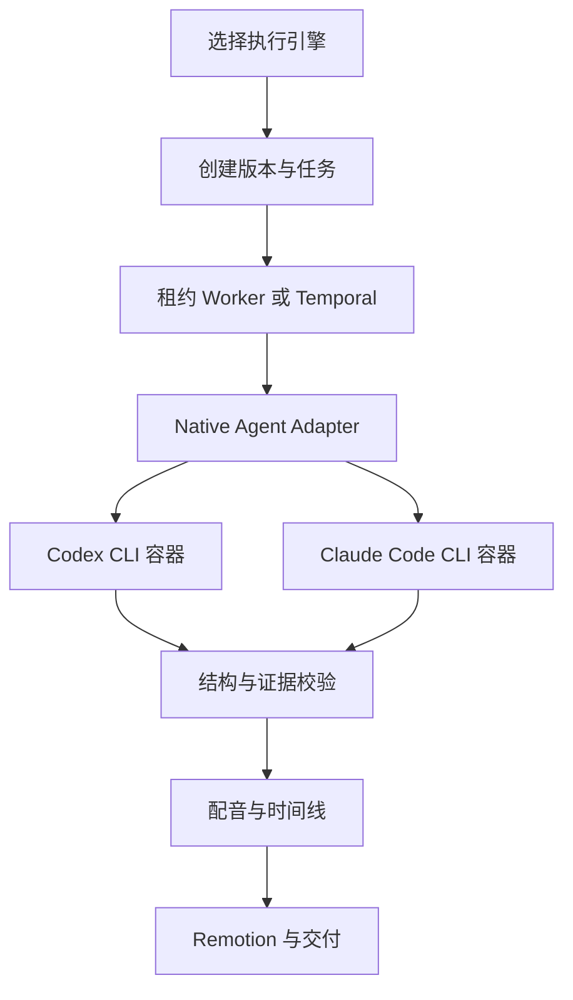

> 本文记录 V2.1 模板兼容模式下的原生设计适配器。V3 工程模式可生成真实 TSX 并通过独立工具执行，优先阅读 docs/engineering-operations.md 与 docs/design/。

# Claude Code / Codex 原生 Agent 接入（V2.1）

## 1. 实现方式与边界

本版通过原生 CLI 的非交互接口运行完整 Agent 循环：Codex `exec` 与 Claude Code `-p`，并非将普通 chat-completions API 改名为 Agent。

原生 Agent 读取不可变项目快照、理解内容、调用允许的读取工具，设计讲解分镜、代码展示片段和声明式动画；平台负责证据与协议校验、逐词对齐、帧预算、声音、Remotion 渲染、导出、权限和任务状态。

**本版输出使用受限动画描述，不加载 Agent 生成的任意 TSX/JavaScript。** diagram 支持节点位置、连接关系、连线标签、按场景时间比例依次出现和脉冲高亮；生成代码片段作为屏幕文字展示。这个边界确保编辑器预览与服务器导出共用安全的渲染器。它不等同于让 Agent 无限制修改平台源码或自行执行仓库构建。

真实项目运行、网页交互捕获仍使用独立源码沙箱，不与带模型凭据的 Agent 容器混用。源项目自动发现的 hooks、skills、MCP 配置和 AGENTS.md/CLAUDE.md 不会直接加载。本版没有自动启用第三方 MCP 或用户自带 Skill；后续可由管理员在适配器中显式接入。

## 2. 调用链



持久化检查点仍由平台负责。重试从已提交阶段继续；原生 CLI 会话是临时的，不能把平台阶段恢复说成厂商会话恢复。切换供应商可复用输入、分镜协议与素材，原生内部会话/记忆不会跨供应商迁移。

## 3. 构建执行镜像

在工程根目录执行，需要可访问对应 npm 包和模型服务的 Docker 主机：

```bash
docker build -f infra/native-agent/Dockerfile \
  --build-arg PROVIDER=codex -t explainer-native-codex:2.1.0 .
docker build -f infra/native-agent/Dockerfile \
  --build-arg PROVIDER=claude-code -t explainer-native-claude:2.1.0 .
```

固定 CLI 版本：Codex 0.165.0、Claude Code 2.1.312。实际下载并验证过版本与参数解析；Docker 镜像尚未在本环境构建。升级 CLI 后先运行协议测试与真实部署验收，不直接更换为 latest。

容器以非 root 用户运行，只读根文件系统、去除 capabilities，限制进程/内存/CPU；输入只读挂载，工作目录与 HOME 为临时文件系统。默认使用 runsc，目标主机需要安装并配置 gVisor。没有该环境会失败，不会改为宿主机执行。

## 4. 专用 Worker 配置

建议 API 与 Native Worker 分进程部署。只在专用 Worker 的私有环境中配置以下值，不把凭据写进提示词、项目源码、Git 或可下载工程包。

```dotenv
EXPLAINER_NATIVE_AGENT_PROVIDERS=codex,claude-code
EXPLAINER_CODEX_API_KEY=替换为部署账号的独立API密钥
EXPLAINER_CLAUDE_API_KEY=替换为部署账号的独立API密钥
EXPLAINER_NATIVE_AGENT_RUNTIME=runsc
EXPLAINER_NATIVE_AGENT_NETWORK=bridge
EXPLAINER_NATIVE_AGENT_TIMEOUT=600
EXPLAINER_NATIVE_AGENT_REPAIRS=1
```

模型分别可用 EXPLAINER_CODEX_AGENT_MODEL / EXPLAINER_CLAUDE_AGENT_MODEL 指定；留空沿用对应 CLI 的默认模型。模型可用性由账号决定。

**认证目前支持管理员 API key 模式。** 不自动读取本机 Codex/Claude 订阅登录、OAuth 文件或浏览器会话；Claude 使用 --bare，不读取订阅登录。环境页仅检测当前进程配置，不代表整个 Worker 集群就绪；最终由领取任务的 Worker 检查。界面不是给每个用户填写供应商密钥的多租户密钥管理系统。原生 Agent 调用按配置账号消耗额度，ChatGPT 订阅不会由本应用自动转成 API 配额。

Worker 可按 README 安装依赖后直接在专用 Docker 主机运行：

```bash
.venv/bin/python -m explainer.worker
# 若启用 Temporal：
.venv/bin/python -m explainer.temporal_worker
```

API 不需要 Docker Socket。Worker 需要调用 Docker 服务；本版挂载输入使用本机绝对路径，要求 Worker 与 Docker daemon 使用同一主机路径视图。若将 Worker 再放入容器，必须做相同绝对路径的 bind mount；不要将远程 daemon 当成本地文件系统使用。

Agent 网络与执行源码的 network=none 不同：需要访问模型服务。生产时配置专用网络、出口代理与供应商域名策略。模型凭据只传给对应 CLI 容器，不传给源码执行容器；更高要求可在部署层使用凭据代理。容器本身不等于出站白名单，默认 bridge 也不代表已限制访问所有其他地址。

EXPLAINER_NATIVE_AGENT_MAX_TURNS 和 BUDGET_USD 为 Claude CLI 的回合/估算预算约束；预算不是精确账单硬上限，且每次修复会启动新的运行。Codex 本版通过任务超时、输出体积与修复次数限制，没有实现精确 token/费用上限。费用管控请结合供应商项目预算。

## 5. 界面与 API

创作页「执行引擎」可选择标准流水线、Codex 或 Claude Code。未配置时任务明确失败，不把原生 Agent 失败藏成模板成功。

```json
{
  "project_id": "项目ID",
  "brief": {
    "title": "项目讲解",
    "prompt": "说明产品价值与系统如何运作",
    "agent_engine": "codex",
    "mode": "storyboard",
    "target_seconds": 90
  }
}
```

提示词、ZIP 与公开 Git 输入都可使用。agent_engine 默认 pipeline，已有请求兼容。mode=storyboard 只生成分镜；automatic 接续现有音画流程。

原生引擎版本的自然语言场景修改也走原生 Agent，在 Worker 异步执行；必须只返回目标场景，其他场景与锁定内容保持原值。旁白未变时复用音频，旁白变化则清除旧音频并重新生成。变更指令成功提交后清空，之后渲染保存的分镜不会再次付费调用 Agent。

API SSE 输出 agent.started / agent.progress / agent.completed / agent.failed；前端显示执行状态。只显示动作类别和状态，不公开模型隐藏思考、原始工具参数或输出。agent-run.json 记录供应商、尝试次数和校验结果；报告可下载并包含在导出工程中。

## 6. 协议与失败处理

`adapters/native_contract.py` 定义严格 AgentDesign；JSON Schema 供两个 CLI 使用，并由平台再次校验。禁止注入素材 ID、runtime 已验证标记、可执行脚本字段和未知证据。diagram 必须引用存在且唯一的节点。

结构校验失败允许有限重新运行，且不会切换供应商。超时、取消、输出超限和租约丢失会中止进程并删除容器。鉴权错误、不可用镜像或预算耗尽均为任务失败；不会返回假成功。用户取消依赖已有 guard 轮询，最坏延迟还包含 Docker 清理时间。

## 7. 实际验证与部署验收

`docs/native-cli-smoke.json`：真实安装的两个官方 CLI，在内核禁止 IPv4/IPv6 socket 的环境下验证参数可解析、无凭据运行被拒绝。**没有调用真实供应商模型。**

后端测试覆盖两个供应商子进程协议夹具、错误结果、超时、结构与引用拒绝、Docker 参数与清理、局部修改、锁定内容与音频复用、SSE 分页。夹具是自编程序，不能标成真实 CLI 推理。

完整渲染夹具：`scripts/verify_native_render.py`。验证自编原生输出数据确实经过平台生成 600 帧视频和可编辑工程，仍不代表真实模型推理。

目标环境构建镜像、准备 runsc 与私有配置后，执行（会消耗对应 API 额度）：

```bash
.venv/bin/python scripts/verify_native_deployment.py --provider codex
.venv/bin/python scripts/verify_native_deployment.py --provider claude-code
```

这会执行真实模型的分镜任务并验证 Agent 产物。当前环境无 Docker 与供应商凭据，未执行此项；部署验收还应覆盖带源码任务、真实推理中途取消、故障恢复和模型输出质量。

## 8. 官方接口依据

- Codex 非交互与结构输出：https://developers.openai.com/codex/noninteractive/
- Claude Code 非交互接口：https://code.claude.com/docs/en/headless
- Claude CLI 工具、权限、输出与预算参数：https://code.claude.com/docs/en/cli-reference

接口核对日期：2026-10-29。
